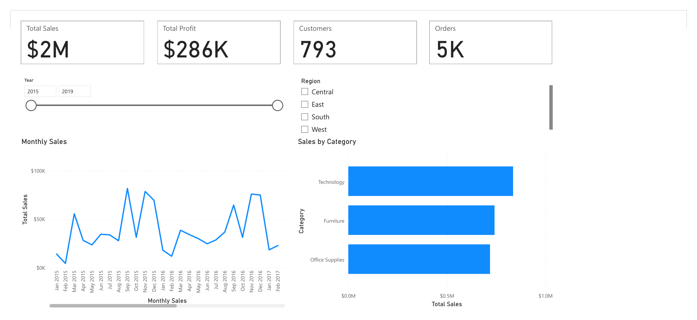
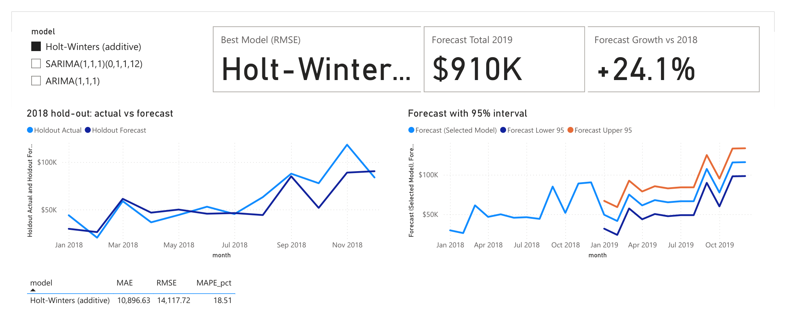
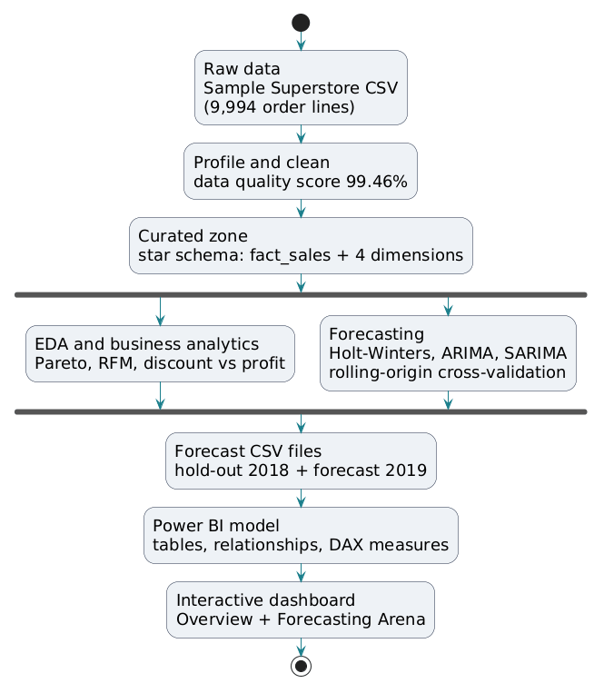
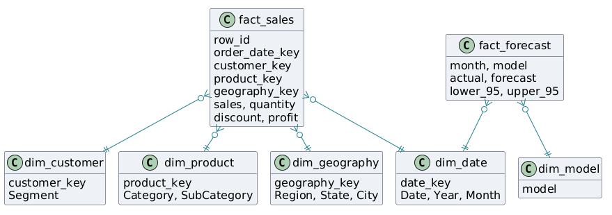
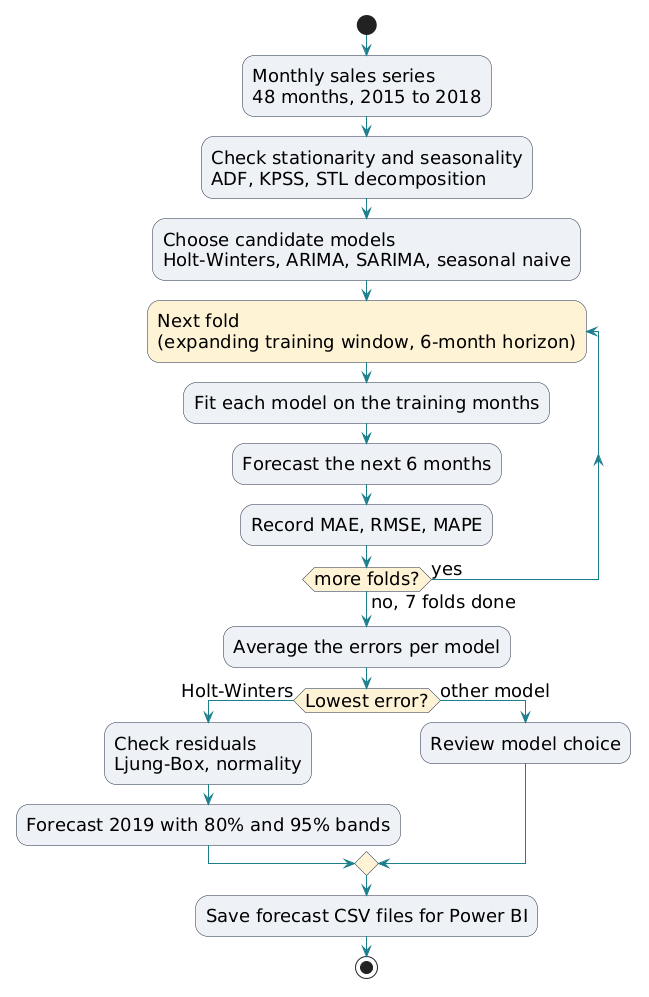
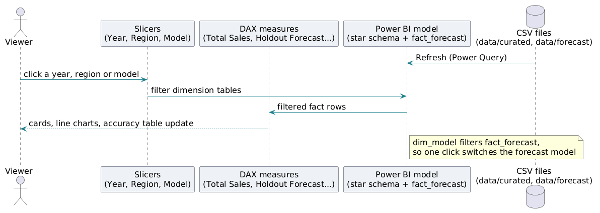
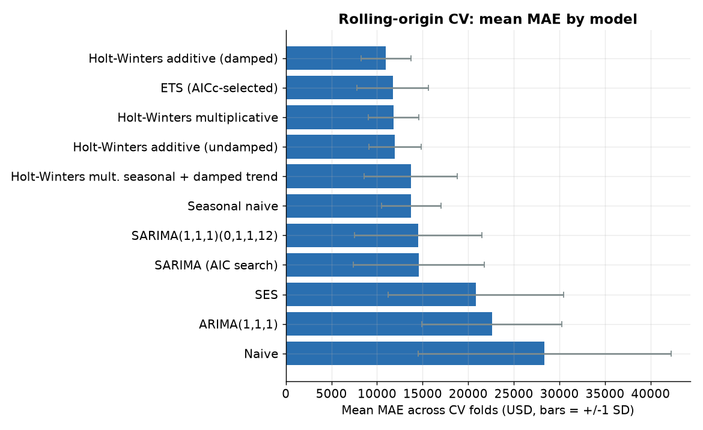
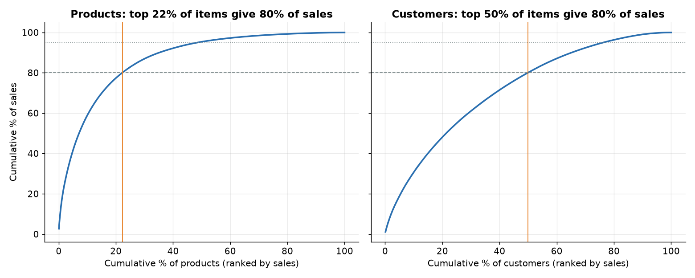

# Complete Explainer: Retail Sales Forecasting Project

Student: Mayur Chauhan. Subject: Data Science (DSC), Semester 7, L.J. Institute of Engineering and Technology.

Title: Retail Sales Forecasting: A Comparison of ARIMA, SARIMA and Holt-Winters Using an Interactive Power BI Dashboard.

How to use this file: read it once from top to bottom. Then re-read sections 5, 7 and 10. Section 11 is your speaking script for the short PPT. Every number in this file is copied from the project reports or CSV files. If a teacher asks for a number that is not here, say "I will check the report" and open the file named in section 8.

Where things are: the final short deck is presentation\Retail_Sales_Forecasting_Short.pptx (7 slides). The Power BI project is in powerbi\pbip (open powerbi\pbip\retail_sales_forecast.pbip), and a packaged file powerbi\retail_sales_forecast.pbix also exists. The dashboard WAS built and its totals were checked against pandas totals. It has exactly TWO pages: Overview and Forecasting Arena. Screenshots (page1_overview.png and page2_forecasting_arena.png) are in powerbi\screenshots. Do not say there are four pages. New in this version: section 12 explains the four diagrams of the deck (with the pictures), and section 13 shows real code excerpts from every script. Section 11 is the short speaking script, and section 14 is the slide-by-slide presentation flow.

Note: some older text files in the project folder (README.md, powerbi\README.md, powerbi\BUILD_CHECKLIST.md, powerbi\pbip\OPEN_ME.md) still say the dashboard is not built or was not opened in Power BI. They were written before the dashboard was made and are out of date on this point. Trust this file and the .pbix.

---

## Tomorrow: what to open and in what order (viva checklist)

Read this the night before. Project folder (call it ROOT): C:\Users\devch\Downloads\DSC\Projects\IP_Retail_Sales_Analytics\

### A. Before leaving home

- [ ] Charge the laptop. Take the charger.
- [ ] Copy the whole ROOT folder to a pen drive as well.
- [ ] Open these, so they are ready (full paths):
  - [ ] ROOT\presentation\Retail_Sales_Forecasting_Short.pptx (the 7-slide deck). Backup: ROOT\presentation\Retail_Sales_Forecasting_Short.pdf
  - [ ] ROOT\powerbi\pbip\retail_sales_forecast.pbip in Power BI Desktop. Click Refresh. Clear all slicers (Year, Region). On page 2, Forecasting Arena, select only Holt-Winters (additive) in the model slicer. Start on the Overview page.
  - [ ] VS Code with the folder ROOT\scripts open. Keep these files in tabs: 02_clean_transform.py, 03_etl_star_schema.py, 04_timeseries_forecast.py, 07_cv_evaluation.py
  - [ ] File Explorer window 1 at ROOT\reports\figures
  - [ ] File Explorer window 2 at ROOT\data\curated (and a tab for ROOT\data\forecast)
- [ ] Check the deck shows: Mayur Chauhan, Enrollment No. 23002171310018, date 01-11-2026 (no "[to be added]").
- [ ] Read section 14 (what to say on each slide) and the cheat card in part D below.

### B. Running order (about 10 minutes)

1. PPT, slides 1 to 7 (about 8 minutes). What to say on each slide is in section 14. Slide 3 and 4 and 5 show the diagrams (explained in section 12).
2. Open the code (only if asked, or if there is time). Show 4 scripts and 1 key line each. The lines are explained in section 13.
   - 02_clean_transform.py: `mask = df[biz].isna().all(axis=1)` then `k = mask.sum(); df = df[~mask].copy()`. Say: "This finds and removes the 806 stray empty rows."
   - 03_etl_star_schema.py: `dim_customer.insert(0, "customer_key", dim_customer.index + 1)`. Say: "This makes the surrogate key of a dimension table. The same idea builds the star schema."
   - 04_timeseries_forecast.py: `train, test = y.iloc[:-H], y.iloc[-H:]`. Say: "Train on 2015 to 2017, test on 2018, in time order."
   - 07_cv_evaluation.py: `origins = list(range(MIN_TRAIN, len(y) - H + 1, STEP))`. Say: "This makes the 7 rolling-origin folds: minimum 24 months, horizon 6, step 3."
3. Open Power BI (optional, about 2 minutes):
   - [ ] Overview page: point at the cards (2.30M dollars sales, 286K dollars profit, 793 customers, 5,009 orders). Click the Year slicer, then the Region slicer. Show that the cards and charts change. Clear them again.
   - [ ] Go to Forecasting Arena. Click each model in the slicer one by one. Point at the accuracy table (MAE, RMSE, MAPE %). For Holt-Winters (additive): MAE 10,896.63, RMSE 14,117.72, MAPE 18.51. Point at the 2019 forecast chart (910K dollars, +24.1 percent versus 2018) and its 95 percent bands.
   - Remember: only Holt-Winters has 2019 values. ARIMA and SARIMA show hold-out values only.
4. If the teacher asks for charts, open ROOT\reports\figures: cv_mae_by_model.png (model comparison), fan_chart_total.png (2019 forecast with bands), ba_pareto_abc.png (Pareto), ba_discount_bands.png (discount versus profit), ts_decomposition.png (trend and season).

### C. If something fails

- [ ] Power BI will not open or is slow: use the screenshots in ROOT\powerbi\screenshots (page1_overview.png and page2_forecasting_arena.png) and slide 7 of the deck. Say: "The dashboard was built and its totals were checked against pandas."
- [ ] The PPT will not open: open ROOT\presentation\Retail_Sales_Forecasting_Short.pdf. If that fails too, use the pen drive copy.
- [ ] Python or VS Code does not work: you do not need to run anything. Show the result files in ROOT\data\forecast (model_accuracy.csv, cv_summary.csv, sales_forecast.csv) and the pictures in ROOT\reports\figures. All results are already saved.
- [ ] You forget a number: say "Let me check the report" and open ROOT\reports\RESULTS_SUMMARY.md. Never guess.

### D. Cheat card: say this if asked

1. Data source: public Sample Superstore retail data (my copy is from a GitHub copy named in the README; also on Kaggle, search "Sample Superstore"). 9,994 order lines, 2015 to 2018, after removing 806 empty stray rows. It is sample data, not a real company's records.
2. What I did: clean the data (quality score 99.46 percent), build a star schema (fact_sales plus four dimensions), forecast monthly sales with three methods, show the results in Power BI.
3. Why Holt-Winters wins: it tracks level, trend and yearly season with few parameters, so it works on short data. Hold-out 2018: MAE 10,897, MAPE 18.5 percent. In cross-validation it beat seasonal naive in 7 of 7 folds.
4. Why SARIMA struggles: only 48 months. The seasonal difference uses up 12 points, so too few points are left for its parameters. Its hold-out MAPE is 34.0 percent. Against Holt-Winters the gap is not significant (p = 0.375).
5. MAE is the average miss in dollars. RMSE punishes big misses more. MAPE is the average miss as a percent of the actual. Lower is better for all.
6. Rolling-origin cross-validation: 7 folds, growing training window (minimum 24 months), 6-month horizon, step 3 months.
7. What the dashboard does: loads my CSV files, lets the user filter by year, region and model, and shows KPIs, monthly sales, the accuracy table, the 2018 hold-out chart and the 2019 forecast with 95 percent bands.
8. Main business findings: margin 29.5 percent with no discount and negative above 20 percent discount (lines above 20 percent lose 135,376 dollars). 22.2 percent of products give 80 percent of sales. This is association, not proof of cause.
9. 2019 forecast: about 910 thousand dollars (733 thousand in 2018), peaks in November and December. It is a guide, not a promise. December 95 percent band: 56,622 to 189,080.
10. Honest limits: only 48 months of data; overlapping CV folds; the dashboard has only two pages (Overview and Forecasting Arena); the 2019 forecast exists only for the best model; only the measures used on the two pages were verified in Power BI, against pandas totals.

---

## 1. The project in one paragraph (the story)

A shop owner has thousands of sales records in one messy file. He cannot easily see what sells, where, and when, and he cannot tell what sales to expect next year. In this project I took a public retail data set (Sample Superstore, 9,994 order lines from 2015 to 2018). I checked its quality and cleaned it. I loaded it into a star schema, which is a tidy set of tables that is easy to analyse. I drew charts and found business facts, for example that heavy discounts lose money. Then I turned the sales into a monthly series of 48 numbers and forecast the next 12 months with three methods: Holt-Winters, ARIMA and SARIMA. I compared them fairly on the same test data using error measures (MAE, RMSE, MAPE) and a stricter test called rolling-origin cross-validation. The simple, damped additive Holt-Winters method won, and SARIMA did not beat even a simple "repeat last year" baseline. At the end I loaded the results into a Power BI dashboard with two pages. The project is honest about its limits: only 48 months of data, so the forecast is a guide and not a promise.

---

## 2. Where the raw CSV comes from

### 2.1 What the README says (exact facts)

- The file is data/raw/superstore.csv.
- The README says it is "a real copy of the public Sample - Superstore dataset".
- The README says it was downloaded from a GitHub address in the leonism/sample-superstore repository, file path data/superstore.csv (the full address is written in README.md; open it to copy it). That is a public GitHub copy of the data set.
- The README says: "You may replace the file with the Kaggle original". The scripts read UTF-8 first and then fall back to latin-1, so the Kaggle file would work unchanged.
- The project brief (Individual_Project_Retail_Sales_Analytics.md) says the data set is "Available on Kaggle (free login)".
- The README does NOT give a Kaggle page address. So do not invent one. If the teacher asks, say: "On Kaggle, search for the name Sample Superstore." Before the viva, open Kaggle yourself, find the exact page you would cite, and confirm it. Also confirm the author or owner name shown on that page. I could not confirm it from the project files.

### 2.2 A caveat found while profiling (very important, say it yourself)

The raw file has 10,800 rows. Of these, 806 are "stray rows" added at the end. They look like leftovers from other Excel sheets, and all their business columns are empty. The real data has 9,994 order lines. Script 02 removes the 806 stray rows. The raw profile showed 504 "duplicate rows" and many "missing values". Almost all of these came from the stray rows. The real order data has only 11 missing Postal Codes (all in Burlington, Vermont) and no other defects. So many cleaning checks show zero. That is the honest result, not a mistake.

### 2.3 What the data is

It is sales of an imaginary US office-supplies store. Each row is one order line: one product on one order. One order can have many lines. There are 5,009 orders, 793 customers and 1,862 products. Orders were placed from 2015-01-03 to 2018-12-30. Ship dates run to 2019-01-05. It is public sample data, not records of a real company.

Totals (from RESULTS_SUMMARY): total sales 2,297,201 dollars, total profit 286,397 dollars, overall margin 12.5 percent. Yearly sales: 2015 = 484,247; 2016 = 470,532; 2017 = 609,206; 2018 = 733,215.

### 2.4 The columns (21 in the raw file)

| Column | Meaning |
|---|---|
| Row ID | Row number of the order line. It is unique. |
| Order ID | Order number. One order has several lines. Example CA-2017-152156. |
| Order Date | Date the order was placed. |
| Ship Date | Date the order was shipped. |
| Ship Mode | Shipping service: 4 kinds, for example Standard Class, Second Class. |
| Customer ID | Customer code, for example CG-12520. |
| Customer Name | Customer full name. |
| Segment | Customer type: Consumer, Corporate or Home Office. |
| Country | Always United States. |
| City | Delivery city (531 distinct). |
| State | Delivery US state (49 distinct). |
| Postal Code | ZIP code. Kept as text so leading zeros are not lost. |
| Region | East, West, Central or South. |
| Product ID | Product code, for example FUR-BO-10001798. |
| Category | Furniture, Office Supplies or Technology. |
| Sub-Category | 17 kinds, for example Bookcases, Chairs, Phones, Copiers. |
| Product Name | Product description. |
| Sales | Line revenue in US dollars, after discount. |
| Quantity | Units on the line (1 to 14). |
| Discount | Discount fraction from 0 to 0.8. 0.2 means 20 percent off. |
| Profit | Line profit in dollars. Negative means a loss. Range about -6,600 to +8,400. |

Cleaning adds 6 derived columns (27 in total): Order Year, Order Month, Order YearMonth, Ship Days (ship date minus order date), Profit Margin (Profit divided by Sales), Unit Price (Sales divided by Quantity).

---

## 3. Step-by-step walkthrough of every script

All scripts are in the folder scripts/. Run everything with: python scripts/run_all.py. Python 3.11, libraries in requirements.txt (pandas, numpy, scikit-learn, scipy, matplotlib, statsmodels, pyarrow, openpyxl).

Plain meanings: a CSV is a text table. Parquet is a compact column-based file format that keeps data types. A "data lake zone" is a folder that holds data at one stage of readiness.

### 3.0 Helper files (not steps, but used by the steps)

- common.py: defines the folder paths (data/raw, data/staging, data/clean, data/curated, data/forecast, reports, reports/figures) and creates them if missing. It reads the raw CSV (UTF-8, then latin-1 as a fallback), parses dates written in mixed formats, builds the monthly sales series, and writes markdown tables.
- style.py: one colour palette and one chart style so all figures look the same.
- tsmodels.py: the library of forecasting models used by scripts 07, 08 and 09. Each model takes a training series and returns a forecast. It holds seasonal naive, naive, SES, the Holt-Winters variants, ETS, ARIMA and SARIMA.

### 3.1 Script 01_data_quality_report.py (profiling)

What: reads the RAW file and measures its quality. It does not change any data.
How: it counts data types, missing values per column, stray rows (rows where all business columns are empty), full duplicates and duplicate Row IDs, inconsistent text, invalid values, date formats and outliers.
Why: you must know what is wrong before you fix it. This is Chapter 6 (data integrity).
Creates: reports/data_quality_report.md.

### 3.2 Script 02_clean_transform.py (cleaning)

What: fixes the data and writes the clean data set.
How (each step is logged with a count):
1. Drop 806 stray rows.
2. Drop duplicates: 0 found. Duplicate Row ID: 0.
3. Text consistency: trim spaces, Title Case for category-like columns. 32 values standardised.
4. Data types: turn Row ID, Sales, Quantity, Discount, Profit into numbers and parse dates from mixed formats. 0 values failed.
5. Missing values: missing key fields 0 (would be dropped); missing Discount 0 (would be set to 0); missing Postal Code 11, filled with the most common code of the same City and State, and the 11 Burlington rows stay "Unknown"; other text 0.
6. Invalid values: Quantity or Sales not above 0: 0 rows; Discount outside 0 to 1: 0; Ship Date before Order Date: 0.
7. Consistency: one Customer ID has one name (OK). 32 Product IDs have several names; the star schema keeps the first name. Sales outliers above Q3 + 1.5 x IQR: 1,167 lines. They are kept because they are genuine large orders; they are only flagged.
8. Add the 6 derived columns.
Then a Chapter 6 demo: scaling (min-max, z-score, log) and encoding (one-hot, label, target).
Why: bad data gives bad forecasts. The log is proof of every fix.
Creates:
- data/clean/superstore_clean.csv and .parquet (9,994 rows, 27 columns)
- data/clean/cleaning_log.csv
- data/clean/superstore_ml_ready_demo.csv (9,994 rows x 28 columns; scaled and encoded demo)
- reports/cleaning_log.md

Terms: Min-max scaling squeezes values into 0 to 1 using (x - min) / (max - min). Z-score scaling gives mean 0 and standard deviation 1 using (x - mean) / std. Both were checked to match scikit-learn. Log transform reduces skew: Sales skewness went from 12.97 to 0.28 after log1p. One-hot encoding makes one 0/1 column per category (14 dummy columns here). Label encoding turns 17 sub-categories into numbers 0 to 16. Target encoding replaces State by its smoothed mean Profit, computed out-of-fold (5-fold) to avoid leakage. Leakage means the answer secretly leaks into the input.

### 3.3 Script 03_etl_star_schema.py (ETL and star schema)

What: moves data through zones and builds the star schema.
How:
- Extract: copy the raw file as-is to staging, all as text, with a _loaded_at time stamp.
- Transform: read the clean file. Build dim_customer (one row per Customer ID), dim_product (one row per Product ID), dim_geography (one row per Country/Region/State/City/Postal Code), dim_date (every calendar day), and fact_sales (one row per order line with keys and numbers).
- Integrity checks with assert (the script stops if one fails): fact rows equal clean rows, keys unique, no orphan foreign keys, total sales preserved.
- Load: write the tables as CSV and parquet into the curated zone.
- OLAP: run seven SQL queries (roll-up, drill-down, slice, dice, cross-tab, top 5 states) on an in-memory SQLite database.
Why: a star schema makes questions fast and simple, and Power BI loves it. This is Chapter 8.
Creates:
- data/staging/stg_superstore_raw.parquet (10,800 rows)
- data/curated/dim_customer, dim_product, dim_geography, dim_date, fact_sales (each as .csv and .parquet)
- reports/olap_examples.md

### 3.4 Script 04_timeseries_forecast.py (first forecast)

What: the first version of the main experiment (Chapter 9).
How: builds the monthly sales series (48 points), decomposes it (trend, seasonality, residual), holds out the last 12 months (2018) as a test, trains three models on the first 36 months (Holt-Winters additive damped, ARIMA(1,1,1), SARIMA(1,1,1)(0,1,1,12)), scores them with MAE, RMSE and MAPE, picks the best by RMSE, refits it on all 48 months and forecasts 2019 with an approximate 95 percent interval (plus or minus 1.96 times the residual standard deviation).
Creates:
- data/forecast/holdout_predictions.csv, sales_forecast.csv, monthly_sales_actual.csv, sales_actual_plus_forecast.csv, model_accuracy.csv
- reports/model_accuracy.md (later scripts 07 and 08 append sections to it)
- reports/figures/ts_decomposition.png, ts_holdout_forecast.png, ts_final_forecast.png

### 3.5 Script 05_gradient_descent_trend.py (optimisation)

What: fits a straight trend line to the monthly sales with gradient descent that I wrote from scratch (Chapter 7).
How: model is sales = slope x month_index + intercept. The cost is mean squared error. The data are standardised first. Learning rate 0.1, 200 epochs, start at zero. The answer is compared with the closed-form (normal equation) and with numpy polyfit.
Result: all three agree exactly: slope 902.0075 dollars per month, intercept 26,661.1742, R squared 0.251.
Creates: reports/gradient_descent_report.md, reports/figures/gd_loss_curve.png, gd_trend_fit.png.

### 3.6 Script 06_eda_charts.py (exploration charts)

What: ten exploratory charts (Chapter 10).
Creates, in reports/figures/: 01_sales_by_category, 02_sales_by_region, 03_sales_by_segment, 04_monthly_sales_trend, 05_top10_products, 06_profit_vs_discount, 07_heatmap_month_year, 08_profit_by_subcategory, 09_top10_states, 10_correlation_heatmap (all .png).

### 3.7 Script 07_cv_evaluation.py (rolling-origin cross-validation)

What: a stricter and fairer test than one hold-out.
How: expanding window. The smallest training set is 24 months, the forecast horizon is 6 months, the origin moves 3 months each time. That gives 7 folds. Eleven models are tested. Metrics: MAE, RMSE, MAPE, sMAPE and MASE. Paired tests (Wilcoxon and paired t) compare each model with the winner.
Creates:
- data/forecast/cv_fold_results.csv, cv_summary.csv, holdout_all_models.csv, cv_paired_tests.csv, cv_sarima_orders.csv
- reports/figures/cv_mae_by_model.png, cv_fold_mae.png, cv_mase_by_model.png
- appends a section to reports/model_accuracy.md

### 3.8 Script 08_diagnostics_forecast.py (diagnostics and 2019 forecast)

What: checks the data and the model, then gives the final forecast with intervals.
How: ADF and KPSS stationarity tests on four versions of the series, STL decomposition, residual tests (Ljung-Box, Jarque-Bera, Shapiro-Wilk), ACF/PACF and QQ plots for Holt-Winters and SARIMA. Then the 2019 forecast from damped additive Holt-Winters with a residual-bootstrap interval (2,000 simulated paths, 80 and 95 percent bands, lower bound clipped at 0).
Creates:
- data/forecast/stationarity_tests.csv, residual_tests.csv, forecast_total.csv
- reports/figures/diag_stl_decomposition.png, diag_residuals.png, diag_acf_pacf.png, fan_chart_total.png
- appends a section to reports/model_accuracy.md

### 3.9 Script 09_segment_forecasts.py (category, region, segment)

What: the same forecasting method for 10 smaller series: 3 categories, 4 regions, 3 segments.
How: for each series, rolling-origin CV with four candidate models (seasonal naive, Holt-Winters additive damped, Holt-Winters multiplicative, SARIMA). The lowest mean CV MAE wins, is refit on all 48 months and forecasts 2019 with 80 and 95 percent intervals.
Creates:
- data/forecast/forecast_category.csv, forecast_region.csv, forecast_segment.csv, forecast_all_series.csv, segment_accuracy.csv, segment_best_models.csv
- reports/figures/seg_forecast_category.png, seg_forecast_region.png, seg_forecast_segment.png

### 3.10 Script 10_business_analytics.py (business layer)

What: finds business insights (Chapter 10).
How: discount bands versus profit, sub-category and product rankings, Pareto 80/20 (ABC classes), RFM customer scoring with K-means clustering (k = 4), seasonality index, state and city profit.
Creates in data/analytics/: abc_summary.csv, city_profit.csv, discount_bands.csv, pareto_customers.csv, pareto_products.csv, product_profit_all.csv, rfm_customers.csv, rfm_k_selection.csv, rfm_segment_profile.csv, seasonality_index.csv, state_profit_map.csv, subcategory_profit.csv, top_bottom_products.csv.
Figures in reports/figures/: ba_discount_bands, ba_subcategory_profit, ba_top_bottom_products, ba_pareto_abc, ba_rfm_k_selection, ba_rfm_segments, ba_rfm_scatter, ba_seasonality_index, ba_state_profit (all .png).

### 3.11 Script 11_data_engineering_extras.py (documentation and checks)

What: data engineering depth (Chapter 8).
How: builds the data dictionary, the quality scorecard, the lineage note, the row-count reconciliation (9 checks), extra OLAP SQL examples, and a small pre-aggregated table.
Creates:
- reports/data_dictionary.md, data_quality_scorecard.md, lineage_and_reconciliation.md, olap_extra_examples.md
- data/data_dictionary.csv, data/reconciliation_counts.csv
- data/curated/agg_monthly_category_region.csv

### 3.12 run_all.py (the runner)

It runs scripts 01 to 11 in order, one after another, using the same Python. If any script fails, it stops and prints which one. Order matters: 02 must run before 03 to 11 (they read the clean file); 04 must run before 07 and 08 because they append to the report 04 creates.

---

## 4. Power BI: from CSV files to dashboard

### 4.1 What is Power BI

Power BI Desktop is a Microsoft tool for building interactive dashboards. It has three layers: Power Query (loads and shapes data), the data model (tables and relationships), and DAX plus visuals (calculations and charts).

### 4.2 Input files generated by Python

From data/curated/ (made by script 03, plus 11):
- fact_sales.csv: 9,994 rows. One row per order line. Columns: row_id, order_id, order_date_key, ship_date_key, customer_key, product_key, geography_key, ship_mode, sales, quantity, discount, profit.
- dim_date.csv: 1,826 rows. One row per calendar day with date_key (yyyymmdd), date, year, quarter, month, month_name, year_month, week_of_year, day, day_of_week, is_weekend.
- dim_customer.csv: 793 rows. customer_key, Customer ID, Customer Name, Segment.
- dim_product.csv: 1,862 rows. product_key, Product ID, Product Name, Category, Sub-Category.
- dim_geography.csv: 632 rows. geography_key, Country, Region, State, City, Postal Code.
- agg_monthly_category_region.csv: a pre-summed table by month, category, sub-category, region and segment.

From data/forecast/ (made by scripts 04, 07, 08, 09):
- monthly_sales_actual.csv: 48 rows, month and actual_sales.
- holdout_predictions.csv: for 2018, the actual value and the prediction of each of the 3 models.
- sales_forecast.csv: the 2019 forecast of the best model with lower_95 and upper_95.
- model_accuracy.csv: MAE, RMSE, MAPE of the 3 models on the hold-out.
- Other forecast files (cv_summary, forecast_total, forecast_category and so on) are extra results that the dashboard does not need.

### 4.3 How Power Query loads them

Power Query uses a language called M. The folder powerbi/power_query holds one script per table:
- 00_DataFolder_parameter.pq: a text parameter holding the path to the data folder (default C:\Users\devch\Downloads\DSC\Projects\IP_Retail_Sales_Analytics\data). If the project moves, change only this.
- 01_fact_sales.pq: reads fact_sales.csv, promotes the header row, sets column types, converts the yyyymmdd keys to real dates, and adds days_to_ship, a discount band (No discount, Low up to 20 percent, Medium 20 to 40 percent, High over 40 percent) and an is_loss_line flag.
- 02_dim_date.pq (and 02b_dim_date_generated.pq as a fallback that builds the calendar inside Power Query), 03_dim_product.pq, 04_dim_customer.pq, 05_dim_geography.pq: load each dimension and rename columns.
- 06_monthly_actual.pq: loads the 48 monthly actuals.
- 07_fact_forecast.pq: combines two files into one long table. The hold-out file is turned from wide (one column per model) to long (one row per month per model) with an "unpivot" step and tagged kind = Holdout. The 2019 forecast is tagged kind = Future. Then they are stacked. Result: 36 hold-out rows (3 models x 12) plus 12 future rows = 48 rows.
- 08_model_accuracy.pq: the accuracy table typed in directly, 3 rows.
- 09_dim_model.pq: a small lookup (short name, family, sort order) used by the Model slicer.

### 4.4 The data model and relationships

A relationship links a column in one table to a column in another so a filter on one table flows to the other. Here every relationship is many-to-one with a single filter direction (no two-way filters). Design from powerbi/model/DATA_MODEL.md (10 relationships):
- fact_sales[order_date_key] to dim_date[date_key]: active.
- fact_sales[ship_date_key] to dim_date[date_key]: inactive. This is a "role-playing dimension": one date table used for two dates (order date and ship date). Only one relationship can be active, so the ship date one is inactive and can be switched on in a measure with USERELATIONSHIP.
- fact_sales to dim_customer, dim_product, dim_geography by their keys.
- monthly_actual[month] and fact_forecast[month] to dim_date[Date].
- fact_forecast[model] to dim_model[model], and model_accuracy[model] to dim_model[model].
- dim_customer to RFM (one-to-one).
dim_date is marked as the date table on the Date column. This is needed for time-intelligence measures.

### 4.5 DAX measures

DAX is the formula language of Power BI. A measure is a formula that is recalculated for whatever the user has filtered. A calculated table is a table made with DAX. The file powerbi/dax/measures.dax holds 84 measures and 2 calculated tables (Top N, RFM). Display folders: Core KPIs, Time Intelligence, Ranking and Share, Discount and Profit, Forecast Arena, and others. Examples and expected check values (computed with pandas, from DAX_MEASURES.md):
- Total Sales = sum of sales = 2,297,200.86. Total Profit = 286,397.02. Profit Margin % = profit divided by sales, ratio of sums = 12.47 percent. Orders = distinct count = 5,009. Customers = 793. Avg Order Value = 458.61.
- Time intelligence: Sales LY (same period last year), YoY % (with Year 2018 selected, +20.36 percent), Sales YTD, Rolling 3M Sales.
- Forecast Arena measures: Best Model (RMSE) = Holt-Winters (additive); Forecast Total 2019 = 910,035.16.
Why a ratio of sums? Averaging row margins would give the wrong answer; you must divide total profit by total sales.

### 4.6 What pages exist and what does NOT exist

Where the file is: the Power BI project is in powerbi\pbip (retail_sales_forecast.pbip with a Report folder and a SemanticModel folder). A packaged powerbi\retail_sales_forecast.pbix also exists. Screenshots of the report are in powerbi\screenshots.

Pages that EXIST (read from powerbi/pbip/.../pages.json):
1. Overview. Contains: KPI cards (Total Sales, Total Profit, Orders, Customers), slicers (Year and Region), a line chart of Total Sales by month, and a clustered bar chart of Total Sales by Category.
2. Forecasting Arena. Contains: a table of model accuracy (model, MAE, RMSE, MAPE), a hold-out line chart (Holdout Actual versus Holdout Forecast), a model slicer, a 2019 forecast line chart with lower and upper 95 percent bounds for the selected model, and cards for Best Model (RMSE), Forecast Total 2019 (910K dollars in the screenshot) and Forecast Growth vs 2018 (+24.1 percent in the screenshot).





NOT built:
- Planned page 3 (customers/RFM and shipping) and planned page 4 (discounts and profit details). They exist only as wireframes in powerbi/layouts/WIREFRAMES.md.
- No RFM page. The RFM analysis was done in Python (script 10). An RFM table is planned in measures.dax, but there is no RFM page in the report.
- Only the best model (Holt-Winters) has 2019 values. ARIMA and SARIMA have hold-out values only.
- I cannot confirm that all 84 DAX measures in measures.dax were run in Power BI. The measures used by the two pages are the ones that are shown and checked.

---

## 5. Forecasting theory from zero

### 5.1 Time series

A time series is a list of numbers measured at regular times. Ours is the total sales of each month: January 2015 to December 2018, which is 48 numbers. Order matters. You cannot shuffle it, because this month depends on earlier months.

Why helpful for retail: stock, staff, cash and promotions must be planned before the sales arrive.

### 5.2 The parts of a series

- Trend: the long-term direction, up or down. Here sales were flat in 2015 to 2016 and grew in 2017 to 2018. The fitted straight line grows 902.01 dollars per month.
- Seasonality: a pattern that repeats every year. Here November (index 185), December (173) and September (164) are high, and February (30) and January (48) are low. 100 means an average month.
- Residual (noise): what is left after trend and seasonality.
- Additive decomposition: series = trend + seasonal + residual. Multiplicative: series = trend x seasonal x residual. Additive fits when the seasonal swing stays about the same size. STL is another decomposition method (Seasonal and Trend using Loess) that is more flexible. Here STL seasonal strength is 0.86 (strong) and trend strength 0.53 (medium). Strength runs from 0 to 1.

### 5.3 Stationarity, ADF and KPSS, differencing

- Stationary: the average, spread and pattern do not change over time. ARIMA needs a stationary series. Our series has trend and seasons, so it is not stationary as it stands.
- ADF test (Augmented Dickey-Fuller): the null hypothesis is "there is a unit root" (non-stationary). A small p-value (below 0.05) says the series is stationary.
- KPSS test: the opposite. Null hypothesis is "stationary". A small p-value says non-stationary.
- The null hypothesis is the "nothing special" assumption the test tries to reject. The p-value is how surprising the data would be if the null were true.
- Results (from model_accuracy.md): level series: ADF p = 0.0002 (stationary), KPSS p = 0.019 (non-stationary). They disagree. That is typical when there is a trend or seasonal pattern but no unit root. First difference (d = 1): ADF p about 0, KPSS p = 0.1, both say stationary. Seasonal difference only: ADF p = 0.543 (unit root), KPSS p = 0.049. Both d = 1 and D = 1: ADF p = 0.0002, KPSS p = 0.047, borderline.
- Differencing: replace each value by its change from the previous value (first difference, d = 1) or from the same month last year (seasonal difference, D = 1, lag 12). This removes trend or seasonality. Over-differencing adds noise, and with only 35 points left the risk is real. With only 48 points the tests have low power, so the decision also uses ACF/PACF plots and the model search.

### 5.4 Naive baselines

- Naive: forecast = last value.
- Seasonal naive: forecast = the value from the same month last year. This is the baseline to beat. If a clever model cannot beat "repeat last year", it is not worth using.
- SES (Simple Exponential Smoothing): a weighted average of the past where recent values weigh more. No trend, no season.

### 5.5 Holt-Winters (exponential smoothing with trend and season)

It keeps three running estimates and updates them each month: the level, the trend and the seasonal pattern. Smoothing numbers (alpha, beta, gamma) decide how fast each one reacts to new data.
- Additive version: seasonal swings are added to the level (same size in dollars each year).
- Multiplicative version: seasonal swings are percentages of the level (bigger when sales are bigger).
- Damped trend: the trend is slowed down over the forecast so it does not grow forever. This is safer for forecasting.
- In this project, the model called "Holt-Winters (additive)" in the 3-model comparison is the damped additive one. In the 11-model table it is called "Holt-Winters additive (damped)".
- Why helpful for retail: few parameters, so it works on short series, and it handles yearly seasons directly.

### 5.6 ARIMA(p,d,q)

ARIMA means AutoRegressive Integrated Moving Average.
- p (AR): how many past values are used to predict the next one.
- d (Integrated): how many times we difference the series.
- q (MA): how many past forecast errors are used.
ARIMA(1,1,1) means one AR term, one difference, one MA term. Plain ARIMA has no seasonal part, so it cannot model yearly peaks. That is why it did worst of the three (MAPE 54.1 percent on the hold-out).

### 5.7 SARIMA(P,D,Q,m)

SARIMA is ARIMA plus a seasonal part. Capital P, D, Q are the seasonal AR, difference and MA orders, and m is the season length (12 for monthly data). SARIMA(1,1,1)(0,1,1,12) means: ordinary part (1,1,1), seasonal part with D = 1 and one seasonal MA term, season 12.
Why it struggled here: a seasonal difference of lag 12 uses up 12 points. A 24-month training window leaves only 12 usable points to estimate up to 5 parameters. Each calendar month is seen only 2 to 3 times. So the estimates are unstable. This does not mean SARIMA is a bad method in general. It needs more data.

### 5.8 Error measures

- MAE (Mean Absolute Error): average size of the miss, in dollars. Easy to explain.
- RMSE (Root Mean Squared Error): square the misses, average, square root. It punishes big misses more.
- MAPE (Mean Absolute Percentage Error): average miss as a percent of the actual value. It is easy to compare but explodes when actuals are small (for example a very low month).
- sMAPE: a symmetric version of MAPE.
- MASE (Mean Absolute Scaled Error): MAE divided by the MAE of the seasonal-naive method on the training data. Below 1 means better than seasonal naive.
Lower is better for all of them.

### 5.9 Hold-out versus rolling-origin cross-validation

- Hold-out: train on 2015 to 2017 (36 months), test on 2018 (12 months). Simple, but the result depends on one lucky or unlucky year.
- Rolling-origin (expanding window) cross-validation: repeat the test many times, each time with a little more training data, and always forecast the months that follow. Here: minimum training 24 months, horizon 6 months, step 3 months, giving 7 folds (the first fold tests 2017-01). It never uses the future to predict the past. It gives a mean and a spread of the error. Caveat: the folds overlap, so they are not independent, and p-values are only indicative.
- Cross-validation is helpful for retail because the model is judged many times, as it would be in real life when forecasts are made every quarter.

### 5.10 Residual diagnostics

A residual is actual minus the model's one-step fitted value. A good model leaves residuals that look like random noise.
- Ljung-Box test: checks whether residuals are still correlated with their own past (autocorrelation). Null: no autocorrelation. p above 0.05 is good.
- Jarque-Bera and Shapiro-Wilk: check whether residuals look normal (bell-shaped). p above 0.05 means no evidence against normality.
- ACF and PACF plots: bars showing correlation at each lag; they should stay inside the blue band. QQ plot: points should lie on a straight line if the data are normal.
- Why helpful for retail: if leftover patterns exist, the model is missing something, and the prediction intervals are untrustworthy.
- Our results: damped Holt-Winters Ljung-Box p = 0.329 (lag 6) and 0.165 (lag 12), Jarque-Bera p = 0.577, Shapiro p = 0.181, so it passes. SARIMA residuals: Ljung-Box lag 12 p = 0.010, so there is leftover autocorrelation. With only 35 to 48 residuals these tests are weak, so passing is not proof.

### 5.11 Prediction intervals

A forecast is a best guess. An interval gives a range. The 95 percent band means the real value should fall inside it about 95 percent of the time, if the model is right. Ours come from a residual bootstrap: shuffle the model's own errors many times (2,000 simulated futures) and read off the range. If the model is wrong, the bands are too narrow.

---

## 6. Star schema, ETL zones, OLAP, gradient descent

### 6.1 Star schema

A star schema has one central fact table and several dimension tables around it, like a star.
- Fact table (fact_sales): holds the numbers (sales, quantity, discount, profit) and keys. Its grain (one row means) is one order line.
- Dimension tables: describe the who, what, where and when: dim_customer, dim_product, dim_geography, dim_date.
- Surrogate key: a plain number (1, 2, 3...) invented for a dimension row, used as the link. Foreign key: a column in the fact table that points to a dimension key.
- Additive measure: can be summed across any dimension (sales, profit, quantity). Discount is not additive, so it is averaged.
- Degenerate dimension: an ID kept in the fact table with no own table (order_id).
- Why: simple joins, fast summing, no repeated text, and Power BI works best with it.

### 6.2 ETL and zones

ETL is Extract, Transform, Load. In this project:
- Raw zone: data/raw/superstore.csv. Untouched original.
- Staging zone: data/staging. An as-is copy in parquet.
- Clean zone: data/clean. After script 02 fixes.
- Curated zone: data/curated. The star schema, ready for Power BI.
Lineage means the trace of where each table came from. Reconciliation means checking counts and totals match at each stage. All 9 reconciliation checks pass (for example raw 10,800 minus 806 stray = 9,994 clean = 9,994 fact rows, and sums of Sales, Profit and Quantity match).

### 6.3 OLAP

OLAP (Online Analytical Processing) means summarising data along dimensions. Operations: roll-up (go to a higher level, months to years), drill-down (go to more detail, year to month), slice (fix one dimension, e.g. Region = West), dice (restrict several dimensions at once), pivot or cross-tab (rows by columns). Script 03 runs real SQL for each. The examples are in reports/olap_examples.md and reports/olap_extra_examples.md.

### 6.4 Gradient descent in plain words

Imagine standing on a hill in fog and wanting to reach the bottom. You feel the slope under your feet and take a small step downhill. Repeat. The "hill" is the cost function: here the mean squared error of a trend line. The "step size" is the learning rate. Each update: new weight = old weight minus learning rate times slope of the cost.
- A tiny learning rate (0.001) is slow: final loss 0.862 after 200 steps.
- A good rate (0.01, 0.1, 0.5) converges to 0.7488.
- Too large a rate (1.05) overshoots and explodes: DIVERGED.
- The result matches the exact formula (normal equation) and np.polyfit: slope 902.0075 dollars per month, intercept 26,661.17. Loss was within 1e-6 of the best after about 28 epochs.
- The trend line alone has R squared 0.251 and RMSE 21,574.53 dollars. It ignores seasonality, which is why we need Holt-Winters and SARIMA.
Gradient descent is the engine behind training of most machine-learning models, which is why it is in the syllabus (Chapter 7). It is not used for the final forecast.

---

## 7. Real results and honest limitations

### 7.1 Forecast comparison on the 2018 hold-out (3 models, from model_accuracy.csv)

| Model | MAE | RMSE | MAPE % |
|---|---|---|---|
| Holt-Winters (additive, damped) | 10,896.63 | 14,117.72 | 18.51 |
| SARIMA(1,1,1)(0,1,1,12) | 15,104.56 | 17,570.51 | 33.98 |
| ARIMA(1,1,1) | 23,450.63 | 27,208.45 | 54.11 |

Best on the hold-out: Holt-Winters.

### 7.2 Rolling-origin CV (7 folds; from RESULTS_SUMMARY)

| Model | CV MAE | CV RMSE | CV MAPE % | 2018 hold-out MAE | hold-out MAPE % |
|---|---|---|---|---|---|
| Holt-Winters additive (damped) | 10,981 | 13,445 | 21.7 | 10,897 | 18.5 |
| Seasonal naive (baseline) | 13,739 | 16,542 | 25.0 | 15,468 | 24.5 |
| SARIMA(1,1,1)(0,1,1,12) | 14,513 | 16,199 | 36.6 | 15,105 | 34.0 |
| ARIMA(1,1,1) | 22,601 | 27,047 | 49.1 | 23,451 | 54.1 |

Other models in the full table (CV MAE): ETS by AICc 11,723; Holt-Winters multiplicative 11,809; Holt-Winters additive undamped 11,976; multiplicative seasonal with damped trend 13,695; SARIMA with AIC search 14,579; SES 20,844; Naive 28,382.

Main findings:
- Damped Holt-Winters beat seasonal naive in 7 of 7 folds (Wilcoxon p = 0.016, the smallest value possible with 7 folds).
- SARIMA did not beat seasonal naive on average (MAE 14,513 versus 13,739). Its error varies a lot (MAE standard deviation 6,974 versus 3,265 for seasonal naive). Plain ARIMA is much worse (MAPE 49 percent).
- Holt-Winters versus SARIMA: mean fold MAE gap 3,532, Holt-Winters better in 4 of 7 folds, Wilcoxon p = 0.375. So the two are not statistically distinguishable.

### 7.3 Diagnostics (see 5.10) and the 2019 forecast

The 2019 forecast (damped additive Holt-Winters, bootstrap bands) runs from 41,476 in February to 115,687 in November and 116,031 in December. The December 95 percent band is 56,622 to 189,080. Forecast total for 2019 is 910,035.16 (dashboard check value), compared with 733,215 in 2018.

Monthly point forecasts for 2019: Jan 49,387; Feb 41,476; Mar 74,998; Apr 61,269; May 67,934; Jun 65,178; Jul 66,496; Aug 66,535; Sep 107,466; Oct 77,579; Nov 115,687; Dec 116,031.

### 7.4 Category, region and segment (best model by CV MAE)

| Series | Best model | CV MAE | 2018 hold-out MAPE % |
|---|---|---|---|
| Furniture | Seasonal naive | 3,344 | 24.0 |
| Office Supplies | HW additive damped | 5,182 | 24.1 |
| Technology | SARIMA(1,1,1)(0,1,1,12) | 7,595 | 46.8 |
| Central | Seasonal naive | 4,836 | 41.4 |
| East | HW additive damped | 6,055 | 39.7 |
| South | HW additive damped | 4,462 | 59.7 |
| West | HW additive damped | 4,130 | 15.4 |
| Consumer | HW multiplicative | 6,770 | 32.6 |
| Corporate | HW additive damped | 5,558 | 49.7 |
| Home Office | Seasonal naive | 4,667 | 41.4 |

Where seasonal naive wins, the 2019 forecast simply repeats 2018. Errors of 15 to 60 percent MAPE mean these are directional, not precise.

### 7.5 Business findings

- Pareto 80/20: 414 of 1,862 products (22.2 percent) give 80.0 percent of sales and 70.6 percent of profit (class A). 959 products (51.5 percent) are class C and give 5.0 percent of sales. Customers are less concentrated: 396 of 793 (49.9 percent) give 80.1 percent of sales.
- Discount versus profit: margin is 29.5 percent with no discount (4,798 lines), 11.6 percent at 10 to 20 percent discount, then negative: -10.1 percent (20 to 30), -19.4 percent (30 to 40), -35.7 percent (40 to 50), -119.2 percent above 50 percent (856 lines, all loss-making). Lines with discount above 20 percent lose 135,376 dollars in total (1,393 lines). Spearman correlation of discount and profit per line is -0.54. This shows association, not proof of cause: product mix is a confounder.
- Sub-categories: Copiers (55,618), Phones (44,516) and Accessories (41,937) earn the most profit. Tables (-17,725), Bookcases (-3,473) and Supplies (-1,189) lose money. Machines have a 1.8 percent margin on 189,239 sales (average discount 31 percent).
- RFM (Recency, Frequency, Monetary value) with K-means, k = 4: Cooling high-value 244 customers (30.8 percent of customers, 51.5 percent of sales, average recency 98 days); Active mid-value 198 (23.4 percent of sales, 20 days); Lapsed mid-value 260 (23.2 percent of sales, 229 days); Lapsed low-value 91 (1.9 percent of sales, 328 days). The segment names are labels I assigned from thresholds, not output by K-means.
- Data quality scorecard overall: 99.46 percent. 9 of 9 reconciliation checks pass.

### 7.6 Honest limitations (say these yourself)

1. Small sample: 48 monthly points. SARIMA is data-hungry. Its weak result reflects the short data, not that SARIMA is bad.
2. CV folds overlap, so the 7 folds are not independent. P-values are indicative only.
3. The model choice is tentative. Damped Holt-Winters leads ETS, undamped Holt-Winters and SARIMA by amounts within fold-to-fold variation. It is clearly better than naive, SES and ARIMA(1,1,1).
4. Growth assumption: sales were flat in 2015 to 2016 and grew in 2017 to 2018. Any forecast assumes this growth and the seasonal pattern continue.
5. Prediction intervals are approximations. They are too narrow if the model is wrong. The 2019 values are forecasts, not expected actuals.
6. Sub-series are noisier, with some hold-out MAPE of 40 to 60 percent.
7. Association, not cause: the discount-profit link is observational. RFM depends on the snapshot date and on k. The silhouette score is highest at k = 2 (0.350) versus 0.254 at k = 4. I chose k = 4 for interpretability.
8. Public sample data, not real company records. 806 stray rows were removed.
9. Power BI has two pages only (Overview and Forecasting Arena).

---

## 8. Where is each file (map)

Project root: C:\Users\devch\Downloads\DSC\Projects\IP_Retail_Sales_Analytics\

| What | Where |
|---|---|
| This explainer | IP_COMPLETE_EXPLAINER.md and IP_COMPLETE_EXPLAINER.pdf (project root) |
| Project brief | ..\Individual_Project_Retail_Sales_Analytics.md (one folder above the project) |
| Main README | README.md |
| Python scripts | scripts\01 to 11, run_all.py, common.py, style.py, tsmodels.py |
| Raw CSV | data\raw\superstore.csv |
| Staging parquet | data\staging\stg_superstore_raw.parquet |
| Clean data | data\clean\superstore_clean.csv (+ .parquet), cleaning_log.csv, superstore_ml_ready_demo.csv |
| Star schema | data\curated\ (fact_sales, dim_customer, dim_product, dim_geography, dim_date, agg_monthly_category_region) |
| Forecast CSVs | data\forecast\ (20 files, for example model_accuracy.csv, holdout_predictions.csv, sales_forecast.csv, cv_summary.csv, forecast_total.csv, segment_best_models.csv) |
| Business analytics CSVs | data\analytics\ (13 files) |
| Data dictionary and reconciliation | data\data_dictionary.csv, data\reconciliation_counts.csv |
| Reports | reports\RESULTS_SUMMARY.md, model_accuracy.md, data_dictionary.md, data_quality_report.md, data_quality_scorecard.md, lineage_and_reconciliation.md, cleaning_log.md, gradient_descent_report.md, olap_examples.md, olap_extra_examples.md, VIVA_PREP.md, Final_Project_Report.md and .pdf |
| Figures (34 PNG) | reports\figures\ : 01 to 10 (EDA), ts_* (decomposition, hold-out, final forecast), cv_* (cross-validation), diag_* (diagnostics), fan_chart_total, seg_forecast_*, ba_* (business analytics), gd_* (gradient descent) |
| Slides | presentation\Retail_Sales_Forecasting_Short.pptx (the final short deck, 7 slides), plus Final, Presentation and Presentation_with_notes versions |
| Diagrams | presentation\diagrams\1.png (pipeline), 2.png (star schema), 3.png (forecast validation), 4.png (dashboard flow) and the PlantUML sources pipeline.puml, star_schema.puml, forecast_validation.puml, dashboard_flow.puml |
| Power BI project (PBIP) | powerbi\pbip\ (open retail_sales_forecast.pbip; Report and SemanticModel folders; two pages: Overview and Forecasting Arena) |
| Power BI packaged file | powerbi\retail_sales_forecast.pbix |
| Dashboard screenshots | powerbi\screenshots\ |
| Power Query scripts | powerbi\power_query\00 to 09 (.pq) |
| DAX | powerbi\dax\measures.dax and DAX_MEASURES.md |
| Data model | powerbi\model\DATA_MODEL.md |
| Wireframes (plans only) | powerbi\layouts\WIREFRAMES.md |
| Theme | powerbi\theme\retail_forecast_theme.json |
| Power BI viva questions | powerbi\VIVA_QA.md |
| Other viva notes | reports\VIVA_PREP.md |

Note: the older text files README.md, powerbi\README.md, powerbi\BUILD_CHECKLIST.md and powerbi\pbip\OPEN_ME.md say the dashboard is not built or not opened. They are out of date on this point.

---

## 9. Glossary

- ACF / PACF: plots of correlation of a series with its own past (autocorrelation / partial autocorrelation).
- Additive: parts are added together.
- ADF test: Augmented Dickey-Fuller test; checks for a unit root.
- AIC / AICc: a score that rewards fit and punishes extra parameters; lower is better. AICc is corrected for small samples.
- ARIMA: AutoRegressive Integrated Moving Average.
- Autocorrelation: a series being correlated with its own past values.
- Bootstrap: re-sampling the model's own errors many times to simulate possible futures.
- Cardinality: the type of relationship between tables (one-to-many, many-to-one, one-to-one).
- Cluster / K-means: grouping similar items; K-means makes k groups around centres.
- Cost function: a number that says how wrong the model is; gradient descent lowers it.
- Cross-validation: testing a model many times on different slices.
- CSV: comma-separated values text file.
- DAX: Data Analysis Expressions, the formula language of Power BI.
- Damped trend: a trend that slows down over time.
- Decomposition: splitting a series into trend, seasonal and residual.
- Degenerate dimension: an ID stored in the fact table without its own dimension table.
- Differencing: replacing values by their change.
- Dimension table: describes who, what, where, when.
- Epoch: one full pass of gradient descent over the data.
- ETL: Extract, Transform, Load.
- ETS: Error, Trend, Seasonal exponential smoothing framework.
- Fact table: central table of numbers and keys.
- Foreign key: a column that points to a key in another table.
- Forecast horizon: how far ahead we forecast.
- Fold: one train/test round in cross-validation.
- Gradient descent: step-by-step downhill search for the lowest cost.
- Grain: what one row of a fact table means.
- Hold-out: data kept aside and used only for testing.
- Holt-Winters: exponential smoothing with trend and season.
- IQR: interquartile range, Q3 minus Q1; used to flag outliers.
- Jarque-Bera / Shapiro-Wilk: tests for normality.
- KPSS test: Kwiatkowski-Phillips-Schmidt-Shin; null is stationarity.
- Leakage: test information sneaking into training.
- Learning rate: size of each gradient descent step.
- Lineage: the trace of where data came from.
- Ljung-Box test: tests for leftover autocorrelation.
- Lag: a number of steps back in time.
- MAE, RMSE, MAPE, sMAPE, MASE: error measures (section 5.8).
- Margin: profit divided by sales.
- Measure (Power BI): a formula that reacts to filters.
- Multiplicative: parts are multiplied.
- Naive / seasonal naive: baseline forecasts (last value / same month last year).
- Normal equation: the exact formula for linear regression.
- Null hypothesis: the default claim a test tries to reject.
- OLAP: Online Analytical Processing.
- Parquet: compact column-based file format.
- Pareto 80/20: a small share of items gives most of the value.
- p-value: how surprising the data are if the null hypothesis were true.
- Power Query / M: the data loading and shaping tool/language in Power BI.
- Residual: actual minus fitted value.
- RFM: Recency (days since last order), Frequency (number of orders), Monetary (total spend).
- Role-playing dimension: one dimension used for several roles, like order date and ship date.
- Rolling-origin: expanding-window cross-validation for time series.
- Seasonality: repeating yearly pattern.
- SARIMA: seasonal ARIMA.
- SES: simple exponential smoothing.
- Silhouette score: measures how well-separated clusters are (higher is better).
- Slicer: a Power BI filter control.
- Spearman correlation: rank-based correlation, from -1 to +1.
- Stationary: statistical behaviour does not change over time.
- STL: Seasonal and Trend decomposition using Loess.
- Star schema: central fact table with surrounding dimensions.
- Surrogate key: a made-up number used as a key.
- Time intelligence: DAX calculations over dates (last year, YTD, rolling).
- Trend: long-term direction.
- Unit root: a feature that makes a series non-stationary.
- Wilcoxon test: rank-based paired test, does not assume normality.
- YoY: year over year.
- YTD: year to date.
- Z-score: value minus mean, divided by standard deviation.

---

## 10. Likely teacher questions and short honest answers

**A. Project and data**

1. What is your project about? I compared three forecasting methods (Holt-Winters, ARIMA, SARIMA) on monthly retail sales and showed the results in a Power BI dashboard.
2. Where did your data come from? From the public Sample Superstore data set. My copy was downloaded from a public GitHub copy named in the README. The project brief says it is also on Kaggle: search for "Sample Superstore".
3. Is it real company data? No. It is a public sample data set, so conclusions are about this sample, not about a real firm.
4. How many rows and what dates? 9,994 order lines, orders from 2015-01-03 to 2018-12-30, after removing 806 stray rows from a 10,800-row file.
5. What is one row? One product on one order (an order line).
6. What were the 806 extra rows? Empty leftovers at the end of the file, probably from other Excel sheets. All business columns were empty. I removed them and logged it.
7. How much dirty data was there really? Very little. Only 11 missing Postal Codes (Burlington, Vermont). Many checks found zero problems. That is the honest result.
8. Did you remove outliers? No. 1,167 sales values are above Q3 + 1.5 x IQR, but they are genuine large orders, so I only flagged them.
9. Why keep Postal Code as text? ZIP codes are labels, not numbers, and leading zeros would be lost.
10. Why does Profit have negatives? Negative means a loss on that line. 1,871 lines lose money.

**B. Data engineering**

11. What is ETL? Extract the raw data, transform (clean and reshape) it, load it into the final tables.
12. What are your zones? Raw, staging, clean, curated.
13. What is a star schema and why use it? One fact table with dimension tables around it. It makes summing and filtering simple and fast, and suits Power BI.
14. What is the grain of fact_sales? One order line.
15. What is a surrogate key? A simple number I created for each dimension row to use as a link.
16. Why is the ship date relationship inactive? Power BI allows one active relationship between two tables. Order date is active; ship date is inactive and can be used with USERELATIONSHIP.
17. How do you know no data was lost in the ETL? Nine reconciliation checks, all pass: row counts and sums of Sales, Profit and Quantity match from clean to fact.
18. What is OLAP? Summarising data by dimensions: roll-up, drill-down, slice, dice, pivot. I ran each as SQL.
19. 32 Product IDs have several names. What did you do? Kept the first name per ID in dim_product. This is why the consistency score is 98.28 percent for that rule.
20. What is your data quality score? Mean of all rules 99.46 percent. The one big lower figure is on the RAW file (92.54 percent non-empty rows).

**C. Forecasting concepts**

21. What is a time series? Numbers measured at regular times in order. Mine: 48 monthly totals.
22. What are trend and seasonality? Trend is the long-term direction. Seasonality is the yearly repeat; here November and December are high, January and February low.
23. What is stationarity and why does ARIMA need it? Stable average and spread over time. ARIMA's maths assumes it, so we difference the series first.
24. ADF and KPSS gave different answers. Why? ADF tests for a unit root and KPSS tests for stationarity, with opposite nulls. On a series with trend and season they can disagree. One regular difference satisfied both.
25. What does d = 1 mean? One round of differencing, to remove the trend.
26. Explain Holt-Winters. It tracks level, trend and season, and updates them each month, giving recent data more weight.
27. Additive versus multiplicative? Additive: season adds the same dollars. Multiplicative: season scales as a percent. Additive was better here.
28. What does damped mean? The trend flattens out in the future so the forecast does not climb forever.
29. Explain ARIMA(1,1,1). One autoregressive term, one difference, one moving-average term.
30. Explain SARIMA(1,1,1)(0,1,1,12). The ARIMA part plus a seasonal part: one seasonal difference and one seasonal MA term, with a 12-month season.
31. Why did you use a seasonal naive baseline? It is the simple benchmark. A model must beat "same as last year" to be worth using.
32. What are MAE, RMSE, MAPE? Average miss in dollars; average miss that punishes big errors; average miss in percent.
33. Why report three error measures? Each shows a different side. MAE is easy to read, RMSE punishes big misses, MAPE gives a percent.
34. Which metric picked the winner? In the 3-model hold-out, lowest RMSE. In CV, lowest mean MAE. Holt-Winters won both ways.
35. Hold-out versus cross-validation? Hold-out is one test on 2018. Rolling-origin CV repeats the test 7 times with growing training data, so it is more reliable.
36. Why not ordinary random cross-validation? It would train on the future and test on the past. Time series need order preserved.
37. What is the Ljung-Box test? It checks whether the residuals still have autocorrelation. A p-value above 0.05 is good; Holt-Winters passed.
38. Why check residuals? If they show a pattern, the model missed something and the intervals cannot be trusted.
39. What is a prediction interval? A range around the forecast. Mine are 80 and 95 percent bands from 2,000 bootstrap simulations.
40. What is MASE? MAE divided by the seasonal-naive MAE on training data. Below 1 beats seasonal naive.

**D. Results**

41. Which model won? Damped additive Holt-Winters: hold-out MAE 10,896.63, RMSE 14,117.72, MAPE 18.51 percent.
42. How does SARIMA compare? Hold-out MAE 15,104.56 and MAPE 33.98 percent. In CV it did not beat seasonal naive (14,513 versus 13,739).
43. Why did SARIMA do badly? Too little data: with 24 to 36 months and a seasonal difference, only 12 to 24 usable points remain for up to 5 parameters. The result is unstable and not a verdict on SARIMA in general.
44. Why was ARIMA the worst? It has no seasonal part, so it cannot follow the yearly peaks. Hold-out MAPE 54.11 percent.
45. Is Holt-Winters significantly better than SARIMA? Not provably. The Wilcoxon p-value is 0.375, so I cannot call them different. It is clearly better than seasonal naive (7 of 7 folds, p = 0.016).
46. What is your 2019 forecast? About 910,035 dollars in total (against 733,215 in 2018), peaking at about 115,687 in November and 116,031 in December.
47. How accurate is it? On the 2018 hold-out the typical miss is 18.5 percent (MAPE). It is a guide, not a promise.
48. How reliable are the sub-series forecasts? Less. Hold-out MAPE ranges from 15.4 percent (West) to 59.7 percent (South). They are directional only.
49. Why is the best model different for different series? Each series has its own pattern and noise. Seasonal naive won for Furniture, Central and Home Office.
50. Did you tune the models? A little: a 16-candidate AIC search for SARIMA inside each fold gave 14,579 CV MAE, no better than the fixed SARIMA. The project did not go further than that, and a 48-point series gives little room for tuning.

**E. Business analytics and optimisation**

51. What does the discount analysis show? Margin is 29.5 percent at no discount, 11.6 percent at 10 to 20 percent, and negative above 20 percent. Lines over 20 percent discount lose 135,376 dollars total. This is an association, not proof of cause.
52. What is the Pareto 80/20 result? 22.2 percent of products (414 of 1,862) give 80 percent of sales.
53. What is RFM? Recency, Frequency, Monetary value of each customer. I grouped customers with K-means into 4 groups.
54. Why k = 4 when silhouette is best at k = 2? Silhouette is 0.350 at k = 2 and 0.254 at k = 4. I chose 4 because it is easier to explain. This is a judgement, and I say so.
55. What is gradient descent and where did you use it? A step-by-step downhill search for the lowest cost. I used it to fit a trend line; it gave slope 902.0075 dollars per month, identical to the exact formula.
56. What happens if the learning rate is too big? It overshoots and diverges. At 1.05 the loss exploded.
57. Why standardise before gradient descent? So both variables have a similar scale and one learning rate works well.
58. Which sub-categories lose money? Tables (-17,725), Bookcases (-3,473), Supplies (-1,189).

**F. Power BI and honesty**

59. How many pages does your dashboard have? Two: Overview and Forecasting Arena. Pages 3 and 4 and an RFM page were planned but not built.
60. What is on the Forecasting Arena page? Model accuracy table, hold-out line chart, model slicer, 2019 forecast line with 95 percent bounds, and cards for best model, 2019 total and growth versus 2018.
61. How did you check the dashboard? I compared the dashboard totals with pandas totals (for example Total Sales 2,297,200.86, Profit 286,397.02). Only the two built pages exist.
62. What is a measure versus a calculated column? A measure is calculated on the fly for the current filter. A calculated column is computed once per row and stored.
63. Why profit margin as a ratio of sums? Averaging row margins gives a wrong value. The correct margin is total profit divided by total sales: 12.47 percent.
64. Does Power BI do the forecast? No. Python made the forecast CSVs. Power BI only loads and displays them.
65. What would you do with more time? Build the missing pages, get more years of data, test more seasonal models, and compare against external factors like holidays.
66. What is the biggest weakness of your project? Only 48 months of data and overlapping CV folds, so model ranking is tentative.
67. Did you write the code yourself? Be ready to explain every script in section 3 in your own words; read the code once before the viva. Do not claim anything you cannot explain.
68. Can the project be repeated? Yes. Run python scripts/run_all.py; scripts run in order and create all files.

---

## 11. Speaking script for the short deck (7 slides)

File: presentation\Retail_Sales_Forecasting_Short.pptx. This is the final deck. Speak slowly. About 30 to 45 seconds per slide. The slide order is: 1 Title, 2 Problem and data, 3 Pipeline (with the pipeline diagram), 4 Star schema (with the star schema diagram), 5 Forecasting comparison (with the validation flowchart), 6 Findings (with 3 figures: discount versus profit, Pareto products versus sales, 2019 sales forecast), 7 Power BI dashboard and conclusion (with images).

Student details for the title slide and footers: Enrollment No. 23002171310018, date 01-11-2026. If any slide of the deck still shows "[to be added]", replace it with these.

**Slide 1 - Title.**
"Good morning. I am Mayur Chauhan, Semester 7, L.J. Institute of Engineering and Technology. My individual project is Retail Sales Forecasting: a comparison of ARIMA, SARIMA and Holt-Winters using an interactive Power BI dashboard."

**Slide 2 - Problem and data.**
"Managers cannot easily see which products, regions and customers drive sales and profit, or what to expect next. I used the public Sample Superstore retail orders. After cleaning there are 9,994 order lines from 2015 to 2018, with total sales of about 2.3 million dollars. The data quality score is 99.46 percent. The raw file had 806 stray empty rows, which I removed and logged."

**Slide 3 - Pipeline (show diagram 1).**
"Read the picture from top to bottom. Raw data is checked and cleaned. Then a star schema is built. After that, business analysis and forecasting run in parallel. The forecast files are loaded in Power BI. Eleven Python scripts do this and run_all.py re-creates everything. Every number in the dashboard comes from a script. Nine out of nine reconciliation checks pass."

**Slide 4 - Star schema (show diagram 2).**
"The centre is fact_sales with 9,994 rows, one per order line, with sales, quantity, discount and profit. Around it are dim_date, dim_product, dim_customer and dim_geography. A second small fact table, fact_forecast, holds actual and forecast values and is filtered by a model table. This is a standard star schema: fast to query and the shape Power BI expects."

**Slide 5 - Forecasting comparison with the validation flowchart (show diagram 3).**
"I turned the sales into 48 monthly values. For each of 7 folds I trained every model on a growing window, forecast 6 months and recorded MAE, RMSE and MAPE. On the 2018 hold-out, Holt-Winters had MAE 10,897 and MAPE 18.5 percent, SARIMA 15,105 and 34.0 percent, and ARIMA 23,451 and 54.1 percent. Holt-Winters beat the seasonal naive baseline in all 7 folds. SARIMA did not beat the baseline on average, because 48 points are too few for it. Holt-Winters is best, but the gap to SARIMA is not statistically significant, with p equal to 0.375."

**Slide 6 - Findings with 3 figures.**
"First figure, discount versus profit: margin is 29.5 percent with no discount and 11.6 percent at 10 to 20 percent discount. Lines with more than 20 percent discount lose 135,376 dollars in total. This is an association, not proof of cause. Second figure, Pareto: 22.2 percent of products, 414 of 1,862, give 80 percent of sales. Third figure, the 2019 forecast: it peaks at about 115,687 in November and 116,031 in December, and the band is wide, for example 56,622 to 189,080 in December. The 2019 forecast total is about 910 thousand dollars, against 733 thousand in 2018."

**Slide 7 - Power BI dashboard and conclusion (show diagram 4 or the screenshots).**
"The dashboard was built in Power BI from the curated and forecast CSV files and checked against pandas totals. It has two pages. Overview has KPI cards, Year and Region slicers, monthly sales and sales by category. Forecasting Arena has the accuracy table, the hold-out chart, a model slicer and the 2019 forecast with 95 percent bands. I planned two more pages but they are not built. Conclusion: damped Holt-Winters is the most accurate of the three methods on this data. But there are only 48 months, so the ranking is tentative and the forecast is a guide, not a promise. Thank you. I am happy to explain any step."

After the slides, the teacher will ask you to explain. Use sections 3, 5, 7, 12 and 13 and the question list in section 10. If you do not know something, say: "I am not sure. Let me check the report." Never invent a number.


---

## 12. The four diagrams and what they mean

The PlantUML source code of the four diagrams is in presentation\diagrams\*.puml: pipeline.puml, star_schema.puml, forecast_validation.puml and dashboard_flow.puml. PlantUML is a free tool that draws diagrams from short text. The PNG pictures used in the deck are presentation\diagrams\1.png, 2.png, 3.png and 4.png. Each one is shown below with an explanation.

### 12.1 Diagram 1: the pipeline (1.png, source pipeline.puml)



How to read it: top to bottom. It is an "activity diagram". The black dot at the top is START and the circle at the bottom is STOP. Each rounded box is one step. Each arrow is the order of the steps. The bar that splits in two (a "fork") means that two steps follow after the same earlier step. The bar that joins them again (an "end fork") means both must finish before the next step.

What each box means and which file it matches:
- Raw data, Sample Superstore CSV, 9,994 order lines: data\raw\superstore.csv (the real file has 10,800 rows with 806 stray ones; see section 2).
- Profile and clean, data quality score 99.46 percent: scripts 01 and 02, output in data\clean and reports\data_quality_scorecard.md.
- Curated zone, star schema: fact_sales plus 4 dimensions: script 03, output in data\curated.
- Fork, left branch, EDA and business analytics (Pareto, RFM, discount versus profit): scripts 06 and 10, output in data\analytics and reports\figures.
- Fork, right branch, forecasting with rolling-origin cross-validation: scripts 04, 07, 08, 09, output in data\forecast.
- Forecast CSV files, hold-out 2018 plus forecast 2019: data\forecast\holdout_predictions.csv and sales_forecast.csv.
- Power BI model, tables, relationships, DAX measures: powerbi\pbip (and the .pbix file).
- Interactive dashboard, Overview plus Forecasting Arena: the two report pages.

Why the steps exist: bad data gives bad results, so we clean first. A star schema makes analysis simple. The analysis and the forecast do not depend on each other, so they can run side by side. Power BI only shows what the scripts produce, so every dashboard number can be re-created.

What to say to the teacher (3 sentences): "This is my pipeline from the raw CSV to the dashboard. I clean the data, build a star schema, then do business analysis and forecasting in parallel. The forecast files are loaded in Power BI, so the whole chain can be re-run with one command."

### 12.2 Diagram 2: the star schema (2.png, source star_schema.puml)



How to read it: it is a "class diagram". Each box is a table. The table name is at the top and the column names are inside. Lines between boxes are relationships. The marks at the line ends show cardinality: the "many" end sits next to the fact table and the "exactly one" end sits next to the dimension. So one dimension row can be used by many fact rows.

What each box means:
- fact_sales (centre): one row per order line, with the keys order_date_key, customer_key, product_key, geography_key and the numbers sales, quantity, discount, profit. File: data\curated\fact_sales.csv, 9,994 rows. Made by script 03.
- dim_date: one row per day (1,826 rows) with Date, Year, Month. File data\curated\dim_date.csv.
- dim_customer: 793 rows, with Segment. dim_product: 1,862 rows, with Category and Sub-Category. dim_geography: 632 rows, with Region, State, City.
- fact_forecast (second fact table): month, model, actual, forecast, lower_95, upper_95. It is made in Power Query from holdout_predictions.csv and sales_forecast.csv (outputs of script 04).
- dim_model: a small lookup of the model names. It filters fact_forecast, so one click on the model slicer changes the forecast chart.
- Both fact tables link to dim_date, so sales and forecast can share one time axis.

Why it exists: summing and filtering are fast and simple, there is no repeated text, and Power BI is built for this shape. The diagram shows the main relationships only. The inactive ship_date_key link and the RFM and model_accuracy tables are described in section 4.4.

What to say to the teacher (3 sentences): "The centre is fact_sales with one row per order line, and four dimension tables describe date, customer, product and place. A second small fact table holds actual and forecast values and is filtered by a model table. This star shape is fast to query and is what Power BI expects."

### 12.3 Diagram 3: the forecast validation flowchart (3.png, source forecast_validation.puml)



How to read it: top to bottom, like a recipe. Rounded boxes are actions. The yellow box with the arrow looping back is the start of a LOOP. The yellow diamonds are decisions (a question with two exits).

What each part means:
- Monthly sales series, 48 months: made by monthly_sales() in common.py (resample by month).
- Check stationarity and seasonality, ADF, KPSS, STL: script 08.
- Choose candidate models, Holt-Winters, ARIMA, SARIMA, seasonal naive: the model library tsmodels.py.
- The loop (Next fold, Fit each model, Forecast the next 6 months, Record MAE, RMSE, MAPE): script 07. The training window grows each time (expanding window) and the forecast horizon is 6 months. The diamond "more folds?" says yes (go back to the loop) or no (7 folds done, go on).
- Average the errors per model: data\forecast\cv_summary.csv.
- Decision "Lowest error?": if Holt-Winters is lowest, check the residuals (Ljung-Box and normality, script 08) and forecast 2019 with 80 and 95 percent bands. If another model were lowest, the right branch says "Review model choice". In this project Holt-Winters had the lowest error, so the left path was taken.
- Save forecast CSV files for Power BI: data\forecast\*.csv.

Why it exists: one test on one year can be lucky. Repeating the test on 7 windows is fairer. Checking residuals shows whether the model left a pattern behind. Only then is the forecast trusted.

What to say to the teacher (3 sentences): "I did not trust one test, so I used rolling-origin cross-validation with 7 folds and a 6-month horizon. For each fold I trained every model, forecast, and recorded MAE, RMSE and MAPE. The model with the lowest average error, Holt-Winters, was then checked on its residuals and used for the 2019 forecast."

### 12.4 Diagram 4: dashboard flow, a sequence diagram (4.png, source dashboard_flow.puml)



How to read it: left to right across the columns, and top to bottom in time. A "sequence diagram" has one column per actor (the boxes at the top). A solid arrow is a request. A dashed arrow is an answer. The note on the right is a comment.

What each column means:
- Viewer: the person who uses the dashboard.
- Slicers (Year, Region, Model): the filter controls on the report pages.
- DAX measures (Total Sales, Holdout Forecast ...): the formulas in powerbi\dax\measures.dax.
- Power BI model (star schema plus fact_forecast): the tables and relationships.
- CSV files (data\curated, data\forecast): the files written by the Python scripts.

Order of arrows: first the CSV files are loaded into the model when you press Refresh (Power Query). Then the viewer clicks a year, region or model. The slicer filters the dimension tables. The filter flows to the fact rows. The DAX measures are recalculated on those rows. The answer goes back to the viewer: cards, line charts and the accuracy table update. The note says that dim_model filters fact_forecast, so one click switches the forecast model.

Why it exists: it shows that the dashboard has no hidden numbers. Everything comes from the CSV files, passes through the relationships and DAX, and appears on screen.

What to say to the teacher (3 sentences): "This diagram shows what happens when I click a slicer. The click filters the dimension tables, the filter flows to the fact tables, and the DAX measures recalculate. So the cards and charts update, and the model slicer even switches the forecast shown."

---

## 13. Code knowledge: real excerpts from each script

Every excerpt below is copied from the file named. Only a few lines are shown, so some lines are cut from their surroundings. Code is in a typewriter font. A very long line may be wrapped in this PDF, but it is one line in the file. The abbreviation pd means the pandas library and np means numpy.

### 13.0 common.py (used by many scripts)

File: scripts/common.py
```
s = df.set_index("Order Date")["Sales"].resample("MS").sum()
s.index.freq = "MS"
```
- set_index("Order Date") makes the order date the row label. ["Sales"] picks the Sales column.
- resample("MS") groups the rows into calendar months ("MS" means Month Start). .sum() adds the sales of each month. The result is the 48-value monthly series.
- The second line tells pandas the series has a fixed monthly frequency. Forecasting models need this.

File: scripts/common.py
```
RAW_FILE = ROOT / "data" / "raw" / "superstore.csv"
```
- Builds the path to the raw file. The slash joins path pieces, so it works on Windows.

### 13.1 Script 01_data_quality_report.py

File: scripts/01_data_quality_report.py
```
business_cols = [c for c in df.columns if c not in ("Row ID", "Order ID")]
empty_rows = int(df[business_cols].isna().all(axis=1).sum())
```
- First line: a list of all columns except Row ID and Order ID.
- Second line: isna() marks empty cells, all(axis=1) asks "is every business cell in this row empty?", and sum() counts such rows. This finds the 806 stray rows.

File: scripts/01_data_quality_report.py
```
full_dups = int(df.duplicated().sum())
rowid_dups = int(df["Row ID"].duplicated().sum())
```
- duplicated() marks a row that is a copy of an earlier row. sum() counts them. The second line counts repeated Row IDs.

File: scripts/01_data_quality_report.py
```
q1, q3 = x.quantile([.25, .75])
lo, hi = q1 - 1.5 * (q3 - q1), q3 + 1.5 * (q3 - q1)
```
- q1 and q3 are the 25th and 75th percentiles. The IQR rule says a value below Q1 - 1.5 x IQR or above Q3 + 1.5 x IQR is an outlier. The script only counts them. It does not delete them.

### 13.2 Script 02_clean_transform.py

File: scripts/02_clean_transform.py
```
mask = df[biz].isna().all(axis=1)
k = mask.sum(); df = df[~mask].copy()
```
- mask is True for stray rows. df[~mask] keeps the rows where mask is False (the ~ means NOT). k is the count removed, and it goes into the log.

File: scripts/02_clean_transform.py
```
new = df[c].astype("string").str.strip().str.replace(r"\s+", " ", regex=True)
```
- Turns the column into text, trims spaces at both ends and replaces runs of spaces by one space.

File: scripts/02_clean_transform.py
```
for c in ("Sales", "Quantity", "Discount", "Profit"):
    df[c] = pd.to_numeric(df[c], errors="coerce")
```
- Converts each column to numbers. errors="coerce" turns a bad value into empty (NaN) instead of crashing.

File: scripts/02_clean_transform.py
```
df["Order YearMonth"] = df["Order Date"].dt.to_period("M").astype(str)
df["Ship Days"] = (df["Ship Date"] - df["Order Date"]).dt.days
df["Profit Margin"] = (df["Profit"] / df["Sales"]).round(4)
```
- Creates new columns. The first gives text like 2015-01. The second subtracts two dates and keeps the days. The third divides profit by sales for each row.

### 13.3 Script 03_etl_star_schema.py

File: scripts/03_etl_star_schema.py
```
dim_customer.insert(0, "customer_key", dim_customer.index + 1)
```
- Adds a first column with numbers 1, 2, 3 ... as the surrogate key (row number plus 1).

File: scripts/03_etl_star_schema.py
```
dim_date["date_key"] = dim_date["date"].dt.strftime("%Y%m%d").astype(int)
```
- strftime("%Y%m%d") writes a date as text like 20171108 and astype(int) makes it a number. This is the date key. (Just before it, pd.date_range builds every day from 1 January of the first year to 31 December of the last ship year.)

File: scripts/03_etl_star_schema.py
```
f = (df.merge(dim_customer[["customer_key", "Customer ID"]], on="Customer ID")
       .merge(dim_product[["product_key", "Product ID"]], on="Product ID")
```
- merge is a join, like SQL JOIN. It attaches the new key to each sales row by matching the ID. This is how the fact table gets its foreign keys.

File: scripts/03_etl_star_schema.py
```
    check(f"no orphan {fk}", fact_sales[fk].isin(dim[key]).all())
```
- isin checks that every foreign key exists in the dimension. all() says yes only if none is missing. check() uses assert, so the script stops if a key is orphaned.

File: scripts/03_etl_star_schema.py
```
    t.to_csv(CURATED / f"{name}.csv", index=False)
    t.to_parquet(CURATED / f"{name}.parquet", index=False)
```
- Saves each table to the curated folder as CSV (for Power BI) and as parquet. index=False leaves out the row numbers.

### 13.4 Script 04_timeseries_forecast.py

File: scripts/04_timeseries_forecast.py
```
train, test = y.iloc[:-H], y.iloc[-H:]
```
- Train and test split by position in time. y.iloc[:-H] is everything except the last H = 12 months (2015 to 2017). y.iloc[-H:] is the last 12 months (2018). No shuffling, because order matters.

File: scripts/04_timeseries_forecast.py
```
dec = seasonal_decompose(y, model="additive", period=SP)
```
- Splits the series into trend, seasonal and residual. model="additive" means the parts are added. period=SP (12) means a yearly cycle in monthly data.

File: scripts/04_timeseries_forecast.py
```
    r = ExponentialSmoothing(s, trend="add", seasonal="add", seasonal_periods=SP, damped_trend=True,
                             initialization_method="estimated").fit(); return r.forecast(h), r
```
- This is Holt-Winters. trend="add" is an additive trend. seasonal="add" is an additive season. seasonal_periods=SP sets the season length to 12. damped_trend=True slows the trend. .fit() finds the smoothing numbers. .forecast(h) predicts h months.

File: scripts/04_timeseries_forecast.py
```
    r = ARIMA(s, order=(1, 1, 1)).fit(); return r.forecast(h), r
    r = SARIMAX(s, order=(1, 1, 1), seasonal_order=(0, 1, 1, SP)).fit(disp=False); return r.forecast(h), r
```
- order=(p, d, q) is the ordinary part. (1, 1, 1) means one AR term, one difference, one MA term.
- seasonal_order=(P, D, Q, m) is the seasonal part. (0, 1, 1, 12) means no seasonal AR, one seasonal difference, one seasonal MA, and a season of 12 months. disp=False hides the optimiser messages.

File: scripts/04_timeseries_forecast.py
```
    return {"MAE": np.mean(np.abs(e)), "RMSE": np.sqrt(np.mean(e ** 2)),
            "MAPE_%": np.mean(np.abs(e) / actual.values) * 100}
```
- e is the error list (actual minus predicted). MAE is the average of the absolute errors. RMSE squares each error, averages, then takes the square root. MAPE is the average of error divided by actual, times 100.

File: scripts/04_timeseries_forecast.py
```
out.to_csv(FORECAST / "sales_forecast.csv", index=False)
```
- Saves the 2019 forecast table. Power BI reads this file.

### 13.5 Script 05_gradient_descent_trend.py

File: scripts/05_gradient_descent_trend.py
```
        err = (w * x + b) - y
        hist.append(np.mean(err ** 2))                  # cost J(w,b)
```
- err is prediction minus real value. The mean of the squared errors is the cost (MSE). It is stored in hist to draw the loss curve.

File: scripts/05_gradient_descent_trend.py
```
        w -= lr * (2 / len(x)) * np.sum(err * x)        # step against the gradient
        b -= lr * (2 / len(x)) * np.sum(err)
```
- The update rule. The slope of the cost with respect to w is (2/n) x sum(err x x). We move w a small step (the learning rate lr) in the opposite direction, which lowers the cost. The same is done for b.

File: scripts/05_gradient_descent_trend.py
```
w_cf, b_cf = np.linalg.solve(X.T @ X, X.T @ y)
slope_np, icpt_np = np.polyfit(x, y, 1)                 # independent check
```
- The first line is the closed-form answer (normal equation), solved in one step with linear algebra. The second line is numpy's own straight-line fit, used as an independent check. All three answers agree.

File: scripts/05_gradient_descent_trend.py
```
lrs = [0.001, 0.01, 0.1, 0.5, 1.05]
```
- The learning rates tested. The last one (1.05) diverges.

### 13.6 Script 06_eda_charts.py

File: scripts/06_eda_charts.py
```
ax.plot(m.index, m.rolling(12).mean(), color=RED, lw=2, label="12-month rolling mean")
```
- rolling(12).mean() gives the average of the latest 12 months. It smooths away the yearly season and shows the trend.

File: scripts/06_eda_charts.py
```
top = df.groupby("Product Name")["Sales"].sum().nlargest(10).sort_values()
```
- groupby gathers rows with the same product name. sum() adds their sales. nlargest(10) keeps the ten biggest. sort_values orders them for the bar chart.

File: scripts/06_eda_charts.py
```
    fig.tight_layout(); fig.savefig(FIGS / name, dpi=130); plt.close(fig); saved.append(name)
```
- Saves the chart as a PNG in reports/figures and closes it to free memory.

### 13.7 Script 07_cv_evaluation.py

File: scripts/07_cv_evaluation.py
```
MIN_TRAIN, H, STEP = 24, 6, 3
origins = list(range(MIN_TRAIN, len(y) - H + 1, STEP))
```
- Minimum training 24 months, horizon 6, step 3. range(24, 43, 3) gives 24, 27, 30, 33, 36, 39, 42: the 7 fold origins.

File: scripts/07_cv_evaluation.py
```
    tr, te = y.iloc[:o], y.iloc[o:o + H]
```
- For each origin o, train on the first o months and test on the next 6. The window expands as o grows.

File: scripts/07_cv_evaluation.py
```
g = cv.groupby("model")[MET]
```
- Groups all fold results by model. The next lines take the mean and standard deviation of each metric (g.mean(), g.std()) and count folds. The result is the table cv_summary.csv.

File: scripts/07_cv_evaluation.py
```
        d = (piv[m] - piv[ref]).dropna()
```
- The difference of MAE per fold between a model and the reference model. The Wilcoxon and paired t tests then use these differences.

File: scripts/tsmodels.py (the metrics function used by script 07)
```
    scale = np.mean(np.abs(train.values[SP:] - train.values[:-SP]))    # in-sample seasonal-naive MAE
```
- This is the scale for MASE: the average change from the same month a year earlier in the training data.

### 13.8 Script 08_diagnostics_forecast.py

File: scripts/08_diagnostics_forecast.py
```
    a = adfuller(s, autolag="AIC")
    k = kpss(s, regression="c", nlags="auto")
```
- Runs the ADF and KPSS tests on a series. autolag="AIC" picks the lags by AIC. regression="c" means the test allows a constant level. The results include the statistic and the p-value.

File: scripts/08_diagnostics_forecast.py
```
variants = {"level": y, "first difference (d=1)": y.diff().dropna(), "seasonal difference (D=1, lag 12)": y.diff(12).dropna(),
```
- y.diff() is the change from the previous month (d = 1). y.diff(12) is the change from the same month last year (D = 1). dropna() removes the empty first values.

File: scripts/08_diagnostics_forecast.py
```
stl = STL(y, period=12, robust=True).fit()
```
- STL decomposition. robust=True keeps outlier months from distorting the trend.

File: scripts/08_diagnostics_forecast.py
```
    lb = acorr_ljungbox(r, lags=[6, 12], model_df=0)
    jb = stats.jarque_bera(r); sw = stats.shapiro(r)
```
- The residual tests: Ljung-Box at lags 6 and 12 (leftover correlation), Jarque-Bera and Shapiro-Wilk (normality).

File: scripts/08_diagnostics_forecast.py
```
fc, how = tm.intervals(interval_models[best_name], y, H)
```
- Gets the 12-month forecast with 80 and 95 percent bands from the model chosen by the cross-validation. how says which interval method was used.

File: scripts/08_diagnostics_forecast.py
```
full.round(2).to_csv(FORECAST / "forecast_total.csv", index=False)
```
- Writes actual and forecast rows in one table, rounded to 2 decimals.

### 13.9 Script 09_segment_forecasts.py

File: scripts/09_segment_forecasts.py
```
CAND = {"Seasonal naive": tm.snaive, "Holt-Winters additive (damped)": tm.hw_add_damped,
        "Holt-Winters multiplicative": tm.hw_mul, "SARIMA(1,1,1)(0,1,1,12)": tm.sarima_fixed}
```
- A dictionary of the four candidate models: a name and the function that makes the forecast.

File: scripts/09_segment_forecasts.py
```
    wide = (df.pivot_table(index=pd.Grouper(key="Order Date", freq="MS"), columns=col, values="Sales", aggfunc="sum")
            .fillna(0))
```
- pivot_table builds one monthly column per category (or region, or segment). Grouper with freq="MS" groups by month. fillna(0) puts 0 where a month has no sales.

File: scripts/09_segment_forecasts.py
```
        best = sub.loc[sub["CV_MAE"].idxmin(), "model"]
```
- idxmin finds the row with the smallest cross-validated MAE. That model name is the best model for this series.

File: scripts/09_segment_forecasts.py
```
    lf.round(2).to_csv(FORECAST / f"forecast_{level.lower()}.csv", index=False)
```
- Saves forecast_category.csv, forecast_region.csv or forecast_segment.csv.

### 13.10 Script 10_business_analytics.py

File: scripts/10_business_analytics.py
```
df["discount_band"] = pd.cut(df["Discount"], bins=bins, labels=labels)
```
- pd.cut puts each discount value into a band (0 percent, 0-10 percent, up to above 50 percent). Then the script sums profit per band.

File: scripts/10_business_analytics.py
```
    g["cum_sales_pct"] = g.sales.cumsum() / g.sales.sum() * 100
```
- Pareto: after ranking products by sales, cumsum() is the running total. Dividing by the total gives the cumulative percent of sales. Products up to 80 percent are class A.

File: scripts/10_business_analytics.py
```
snap = df["Order Date"].max() + pd.Timedelta(days=1)
```
- The snapshot date for RFM: one day after the last order. Recency means the days between a customer's last order and this date.

File: scripts/10_business_analytics.py
```
X = StandardScaler().fit_transform(np.log1p(rfm[["recency_days", "frequency", "monetary"]]))
```
- log1p reduces skew, and StandardScaler gives each column mean 0 and standard deviation 1, so no column dominates K-means.

File: scripts/10_business_analytics.py
```
km = KMeans(n_clusters=K, n_init=20, random_state=42).fit(X)
```
- K-means with K = 4 groups. n_init=20 tries 20 starting points and keeps the best. random_state=42 makes the result repeatable.

### 13.11 Script 11_data_engineering_extras.py

File: scripts/11_data_engineering_extras.py
```
add("Validity", "Sales > 0", (clean.Sales > 0).sum(), n)
add("Validity", "Discount within [0, 1]", clean.Discount.between(0, 1).sum(), n)
```
- Each quality rule counts how many rows pass its test. The score is passing divided by checked. The mean of all scores is 99.46 percent.

File: scripts/11_data_engineering_extras.py
```
agg = (f.groupby(["year", "quarter", "month", "year_month", "Category", "Sub-Category", "Region", "Segment"], as_index=False)
       .agg(order_lines=("row_id", "size"), orders=("order_id", "nunique"), sales=("sales", "sum"), profit=("profit", "sum"),
```
- groupby with many columns makes one row per combination. agg(...) computes the number of lines, the distinct orders, and the sums of sales and profit. as_index=False keeps the group columns as normal columns.

File: scripts/11_data_engineering_extras.py
```
assert abs(agg.sales.sum() - clean.Sales.sum()) < 1e-6 and abs(agg.profit.sum() - clean.Profit.sum()) < 1e-6
```
- A safety check: totals of the aggregate table must equal the clean data. If not, the script stops.

File: scripts/11_data_engineering_extras.py
```
agg.round(4).to_csv(CURATED / "agg_monthly_category_region.csv", index=False)
```
- Saves the pre-summed table for Power BI.

### 13.12 run_all.py

File: scripts/run_all.py
```
    r = subprocess.run([sys.executable, str(HERE / s)], cwd=HERE.parent)
    if r.returncode != 0:
        sys.exit(f"FAILED at {s} (exit code {r.returncode})")
```
- Runs each script as a separate program with the same Python. returncode 0 means success. Any other number stops the whole run and prints which step failed.

---

## 14. Presentation flow: what to say on each slide, page by page

This section follows the CURRENT deck presentation\Retail_Sales_Forecasting_Short.pptx. I read its text with python-pptx. Total time: about 8 to 10 minutes. Order of the whole session: (1) show the PPT and speak slide by slide, (2) then explain the project in more detail if the teacher asks (use sections 3, 5, 7, 13), (3) optionally open the Power BI file powerbi\pbip\retail_sales_forecast.pbip (or the .pbix) and click the slicers.

Real dashboard screenshots exist now. Page 1, Overview, unfiltered, shows 2.30M dollars sales (exact value 2,297,200.86), 286K dollars profit, 793 customers and 5K orders (exact 5,009). Page 2, Forecasting Arena, shows the Holt-Winters (additive) model selected, 910K dollars 2019 forecast and +24.1 percent growth versus 2018.


Student details to show on slide 1 and in the footer of every slide: Mayur Chauhan, Enrollment No. 23002171310018, date 01-11-2026. If the deck still shows "[to be added]", replace it.

### Slide 1 - Title (timing: 30 seconds)

What is visible: "DATA SCIENCE (DSC) | INDIVIDUAL PROJECT", the title "Retail Sales Forecasting", the subtitle "A Comparison of ARIMA, SARIMA and Holt-Winters Using an Interactive Power BI Dashboard", and your name, semester 7, L.J. Institute of Engineering and Technology, with the enrollment number (23002171310018) and the date (01-11-2026).

Spoken script: "Good morning, sir or madam. I am Mayur Chauhan from Semester 7. My individual project is called Retail Sales Forecasting. I compare three forecasting methods, ARIMA, SARIMA and Holt-Winters, on monthly retail sales. I also built a Power BI dashboard to show the results. First I will show a short presentation. After that I will explain the project step by step."

Numbers to quote: none. Point at: the title and the subtitle (the three method names).
Transition: "Let me start with the problem and the data."
Likely questions:
- Why did you choose forecasting? Answer: Retailers must plan stock and staff before the sales arrive.
- What does the Power BI dashboard add? Answer: It lets a user filter the data and switch the forecast model without code.

### Slide 2 - Problem and data (timing: 60 to 70 seconds)

What is visible: three bullets (Problem, Data, Goal) and four number cards: 9,994 order lines 2015 to 2018; 99.46 percent data quality score; 2.30M dollars total sales; 12.5 percent overall profit margin. The footer line says: real data, cleaned and checked before any model is fitted. The bullet says the data is the public Sample Superstore retail orders (GitHub copy), kept unchanged in data/raw, with 806 empty rows removed.

Spoken script: "The problem is simple. Managers cannot easily see which products, regions and customers bring sales and profit, or what to expect next. I used the public Sample Superstore data. It is not a real company's private data. The raw file had 806 empty rows at the end, so I removed them and kept 9,994 order lines from 2015 to 2018. Total sales are about 2.3 million dollars and the profit margin is 12.5 percent. My data quality score is 99.46 percent. My goal was to clean the data, build a star schema, forecast monthly sales with three methods and compare them."

Numbers to quote: 9,994 order lines; 806 stray rows; 2015 to 2018; 2,297,201 dollars sales (2.30M); 286,397 dollars profit; 12.5 percent margin; 99.46 percent quality score.
Point at: the four number cards, one by one.
Transition: "Now let me show how the data moves from the raw file to the dashboard."
Likely questions:
- Is this real company data? Answer: No. It is a public sample data set, so results describe this sample only.
- What is the 99.46 percent? Answer: The mean of the pass/fail quality rules in script 11, computed on the cleaned data.

### Slide 3 - Pipeline (timing: 60 seconds)

What is visible: the pipeline diagram (diagram 1) and a numbered list: 1 Check quality 99.46 percent; 2 Clean and fix types; 3 Build the star schema; 4 Explore: Pareto, RFM, discounts; 5 Forecast with three methods and test them; 6 Save CSV files; 7 Power BI reads the CSV files. Footer: every number in the dashboard comes from a script, so the whole pipeline can be re-run.

Spoken script: "This is my pipeline. I read the picture from top to bottom. First I check the quality of the raw data. Then I clean it and fix the data types. Then I build a star schema. After that, two things happen side by side. I explore the data with Pareto, RFM and discount analysis, and I forecast with three methods and test them. The forecasts are saved as CSV files and Power BI reads them. Eleven Python scripts do all this, and one command, run_all.py, runs them all in order."

Numbers to quote: 11 scripts; 99.46 percent; 9 of 9 reconciliation checks pass.
Point at: the fork in the diagram (analysis and forecasting in parallel), then the last box (dashboard).
Transition: "The key step in this pipeline is the data model, so let me show it."
Likely questions:
- Why do you clean before modelling? Answer: Bad data gives bad forecasts, and every fix is logged in cleaning_log.md.
- Can the result be reproduced? Answer: Yes, python scripts/run_all.py recreates all files.

### Slide 4 - Data model: star schema (timing: 60 seconds)

What is visible: the star schema diagram (diagram 2), a table of row counts (fact_sales 9,994; dim_date 1,826; dim_product 1,862; dim_customer 793; dim_geography 632; fact_forecast 48; dim_model 3), three bullets and a footer: standard star schema, fast to query and the shape Power BI expects.

Spoken script: "The centre of the star is fact_sales. It has 9,994 rows, one for each order line, with sales, quantity, discount and profit. Around it are four dimension tables: date, product, customer and geography. They describe each sale. I added a second fact table, fact_forecast, with 48 rows. It holds actual and forecast values for each month and model. A small table, dim_model, lets one slicer switch the forecast model. This design is fast to query and Power BI is made for it."

Numbers to quote: the row counts in the table; fact_forecast 48 = 36 hold-out rows + 12 future rows.
Point at: the centre box, then one dimension, then the table of rows on the right.
Transition: "With this clean model, I can now come to the main part: the forecast."
Likely questions:
- What is the grain of the fact table? Answer: One order line.
- Why is fact_forecast separate? Answer: Forecast rows have a month and a model, not an order, so they need their own table.

### Slide 5 - Forecasting: how the models were compared (timing: 100 to 120 seconds)

What is visible: the validation flowchart (diagram 3), another picture (a chart; check by eye which one it is), a table, and a footer. The table: Holt-Winters (damped): CV MAE 10,981, CV MAPE 21.7 percent, 2018 MAPE 18.5 percent. Seasonal naive: 13,739, 25.0, 24.5. SARIMA(1,1,1)(0,1,1,12): 14,513, 36.6, 34.0. ARIMA(1,1,1): 22,601, 49.1, 54.1. Footer: Holt-Winters has the lowest error, but its gap to SARIMA is not statistically significant (p = 0.375).

Spoken script: "Here I compare the models. I turned the sales into 48 monthly values. I did not trust one test, so I used rolling-origin cross-validation, shown in the flowchart. The training window grows. Each time I forecast 6 months and record the errors. This is repeated for 7 folds. The table shows the average error. Damped Holt-Winters has the lowest error, with an MAE of 10,981 and a hold-out MAPE of 18.5 percent. It beat the seasonal naive baseline in all 7 folds. SARIMA did not beat the baseline on average, because 48 points are too few for it. The gap between Holt-Winters and SARIMA is not significant, with p equal to 0.375."

Numbers to quote: 7 folds; 6-month horizon; minimum training 24 months; CV MAE 10,981 versus 13,739 (seasonal naive), 14,513 (SARIMA), 22,601 (ARIMA); hold-out MAE 10,897 versus 15,105 (SARIMA) and 23,451 (ARIMA); hold-out MAPE 18.5, 34.0, 54.1 percent; p = 0.016 against seasonal naive; p = 0.375 against SARIMA.
Point at: the loop in the flowchart, then the first row of the table, then the p-value in the footer.
Transition: "So Holt-Winters wins on error. Now let me show what the data says about the business."
Likely questions:
- Why did SARIMA do badly? Answer: Seasonal differencing uses up 12 points, leaving too few to estimate its parameters, so it is unstable on 48 months.
- What is MAPE? Answer: The average error as a percent of the actual value; lower is better.

### Slide 6 - Findings (timing: 90 seconds)

What is visible: three figures with captions: "Discount vs profit", "Pareto: products vs sales", "2019 sales forecast". Three bullets: margin is 29.5 percent with no discount and 11.6 percent at 10 to 20 percent discount, and lines above 20 percent discount lose 135,376 in total; 22.2 percent of products (414 of 1,862) give 80 percent of sales; Holt-Winters forecasts about 910K dollars for 2019. Footer: discounting is the main profit risk; Holt-Winters is the best forecaster here.

Spoken script: "These are my main findings. The first chart shows discount against profit. With no discount the margin is 29.5 percent. At 10 to 20 percent it is 11.6 percent. Above 20 percent, order lines lose money, 135,376 dollars in total. This is an association, not proof of cause, because product mix also matters. The second chart is the Pareto chart. 414 of 1,862 products, 22.2 percent, give 80 percent of sales. The third chart is the 2019 forecast. Holt-Winters forecasts about 910 thousand dollars for 2019, against 733 thousand dollars in 2018, with a wide band."

Numbers to quote: 29.5 percent; 11.6 percent; 135,376 dollars on 1,393 lines; 414 of 1,862 products give 80.0 percent of sales and 70.6 percent of profit; 2019 forecast total 910,035 (910K); 2018 sales 733,215; Spearman -0.54.
Point at: the discount bars that turn negative, the Pareto curve crossing 80 percent, and the forecast peak in November and December (115,687 and 116,031).
Transition: "Finally I will show the dashboard where users can explore all this."
Likely questions:
- Does discount cause loss? Answer: Not proven. It is an association, and heavily discounted lines sit in certain sub-categories.
- How reliable is the 910K forecast? Answer: It is a guide. The December 95 percent band is 56,622 to 189,080 and the 2018 hold-out error was 18.5 percent MAPE.

### Slide 7 - Power BI dashboard and conclusion (timing: 90 to 100 seconds)

What is visible: three pictures (the dashboard screenshots and a related picture; check by eye which are which), three bullets and a footer. Bullets: Built: Overview and Forecasting Arena pages with Year, Region and Model slicers. Limits: 48 months of data, overlapping folds, two pages, the 2019 forecast covers the best model only. Conclusion: Holt-Winters forecasts retail sales best here, and the dashboard lets users compare the three methods. Footer: answer to the title: Holt-Winters is the most accurate of the three methods on this data.

Spoken script: "The dashboard is built in Power BI from my CSV files. I checked its totals against pandas. It has two pages. The Overview page shows 2.30 million dollars of sales, 286 thousand dollars of profit, 793 customers and 5,009 orders, with Year and Region slicers. The Forecasting Arena page lets you pick a model and see the accuracy table, the 2018 hold-out chart and the 2019 forecast with 95 percent bands. I planned two more pages, but they are not built. My conclusion: Holt-Winters is the most accurate of the three methods on this data. But with only 48 months, the ranking is tentative. Thank you."

Numbers to quote: 2,297,200.86 sales; 286,397.02 profit; 793 customers; 5,009 orders; Holt-Winters hold-out MAE 10,896.63, RMSE 14,117.72, MAPE 18.51 percent; 2019 forecast 910K; growth +24.1 percent versus 2018.
Point at: page 1 cards, the Year slicer, then on page 2 the model slicer and the 910K and +24.1 percent cards.
Transition (end): "That is the end of the slides. I am happy to explain any step in more detail, or to open the Power BI file."
Likely questions:
- How many pages does the dashboard have? Answer: Two, Overview and Forecasting Arena. Pages 3 and 4 and an RFM page are not built.
- Does Power BI compute the forecast? Answer: No. Python makes the forecast CSV files and Power BI loads and shows them.

### Timing summary

| Slide | Seconds |
|---|---|
| 1 Title | 30 |
| 2 Problem and data | 60 to 70 |
| 3 Pipeline | 60 |
| 4 Star schema | 60 |
| 5 Forecasting comparison | 100 to 120 |
| 6 Findings | 90 |
| 7 Dashboard and conclusion | 90 to 100 |
| Total | about 8 to 9 minutes (up to 10 with the optional dashboard demo) |

### If the teacher interrupts

- Stop, listen to the whole question, and answer in two or three sentences. Then say "May I continue with the slide?"
- If you do not know: "I am not sure. In my report the value is ... let me check." Open the file named in section 8. Never guess a number.
- If the teacher asks for theory (ADF, ARIMA, MAPE), use section 5. For code, use section 13. For the diagrams, use section 12.
- If a question is about something you did not build (pages 3 and 4, an RFM page, forecasts of ARIMA and SARIMA for 2019), say honestly that it is not built and that it is listed as a limit.
- If the dashboard demo is asked for: open powerbi\pbip\retail_sales_forecast.pbip (or the .pbix), click a Year, then go to Forecasting Arena and click each model in the slicer. Keep the screenshots as a backup in case Power BI is slow.

---

## 15. Slide 5 and slide 6 terms: every word explained

Everything here comes from the scripts (07, 08, 10, tsmodels.py) and the reports (model_accuracy.md, RESULTS_SUMMARY.md). Read this before the viva. Slide 5 is the forecasting table. Slide 6 has the Pareto chart.

### 15.1 CV: cross-validation and rolling-origin CV

Full form: CV means cross-validation. It means testing a model several times on different slices of the data, instead of once.

Plain definition: In normal cross-validation the data are shuffled. A time series cannot be shuffled, because the future must never be used to predict the past. So we use rolling-origin CV. The "origin" is the point in time where the training data ends. We move the origin forward and test again.

How it works in this project (script 07):
- Expanding window: the training data always starts in January 2015 and grows as the origin moves forward.
- Minimum training length: 24 months.
- Horizon: 6 months. Each fold forecasts the next 6 months after the origin.
- Step: 3 months. The origin moves 3 months each time.
- Result: 7 folds. In the code, the origins are the training lengths 24, 27, 30, 33, 36, 39 and 42 months. The first fold tests from 2017-01.
- The test windows overlap (6-month horizon, 3-month step), so the folds are not independent. P-values are only indicative.

Tiny worked example: Fold 1 trains on Jan 2015 to Dec 2016 (24 months) and forecasts Jan to Jun 2017. Fold 2 trains on Jan 2015 to Mar 2017 (27 months) and forecasts Apr to Sep 2017. And so on until fold 7 trains on 42 months. Every model gets the same folds, so the comparison is fair.

What to say to the teacher: "One test on one year can be lucky. Rolling-origin cross-validation repeats the test 7 times with a growing training window and a 6-month forecast horizon, always testing on data that comes after the training data. This gives an average error and also shows how stable each model is."

### 15.2 MAE, RMSE, MAPE: formulas and when to prefer each

Notation: for each forecast month, error = actual minus forecast. The code in tsmodels.py is: MAE = np.mean(np.abs(e)); RMSE = np.sqrt(np.mean(e ** 2)); MAPE = np.mean(np.abs(e) / a) * 100.
- MAE (Mean Absolute Error) = the average of the absolute errors. It is in dollars. Prefer it when you want an error that is easy to explain and that treats every miss equally. It is the main measure used to choose the winner in cross-validation.
- RMSE (Root Mean Squared Error) = square each error, take the average, then the square root. It is in dollars. Big misses count much more than small ones. Prefer it when large errors are especially costly. RMSE is always at least as large as MAE.
- MAPE (Mean Absolute Percentage Error) = the average of the absolute error divided by the actual value, times 100. It is in percent. Prefer it to compare series of different size. Be careful: it explodes when the actual value is small (for example a very weak month such as February 2018, actual 20,301).

Tiny worked example, real numbers (Holt-Winters on the first three months of 2018 only, from data\forecast\holdout_predictions.csv). This is only to show the arithmetic. The figures for all 12 months are MAE 10,896.63, RMSE 14,117.72 and MAPE 18.51 percent.

| Month | Actual | Holt-Winters forecast | Error (actual minus forecast) | Absolute error | Absolute error / actual |
|---|---|---|---|---|---|
| Jan 2018 | 43,971.37 | 29,667.48 | 14,303.89 | 14,303.89 | 32.53 percent |
| Feb 2018 | 20,301.13 | 26,181.58 | -5,880.45 | 5,880.45 | 28.97 percent |
| Mar 2018 | 58,872.35 | 61,327.06 | -2,454.71 | 2,454.71 | 4.17 percent |

- MAE of these 3 months = (14,303.89 + 5,880.45 + 2,454.71) / 3 = 22,639.05 / 3 = 7,546.35 dollars.
- RMSE = square root of the mean of the squared errors = 9,040.77 dollars. It is larger than the MAE because of the big January miss.
- MAPE = (32.53 + 28.97 + 4.17) / 3 = 21.89 percent.

What lower is better means: all three measure the size of the miss. A smaller number means the forecast was closer to the real sales. Zero would be a perfect forecast. So the model with the lowest error is the best on that measure.

What to say to the teacher: "MAE is the average miss in dollars. RMSE punishes big misses more. MAPE gives the miss as a percent of the actual. For all three, lower is better. I used MAE for the cross-validation ranking and I also report RMSE and MAPE."

### 15.3 The columns of the slide 5 table

- CV MAE: the MAE of each of the 7 folds, averaged (the "MAE_mean" column of data\forecast\cv_summary.csv). It measures the typical miss over many forecast windows. In dollars per month.
- CV MAPE %: the MAPE of each fold, averaged. In percent.
- 2018 MAPE %: the MAPE on the single held-out year 2018. The model is trained on Jan 2015 to Dec 2017 (36 months) and then forecasts the 12 months of 2018, which it has never seen. It is compared with the real 2018 sales. In percent.
- Hold-out means data kept aside and used only for testing.

Slide 5 table, row by row (numbers from the report):

| Model on the slide | CV MAE | CV MAPE % | 2018 MAPE % | How to read it |
|---|---|---|---|---|
| Holt-Winters (damped) | 10,981 | 21.7 | 18.5 | Best on all three columns. It missed by about 11 thousand dollars a month on average, about 22 percent in cross-validation and 18.5 percent on 2018. |
| Seasonal naive | 13,739 | 25.0 | 24.5 | The baseline: repeat the same month of last year. It is the bar to beat. Holt-Winters beat it in 7 of 7 folds (Wilcoxon p = 0.016). |
| SARIMA(1,1,1)(0,1,1,12) | 14,513 | 36.6 | 34.0 | Worse than the simple baseline on average. Its error swings a lot between folds (MAE standard deviation 6,974 against 3,265 for seasonal naive). |
| ARIMA(1,1,1) | 22,601 | 49.1 | 54.1 | Worst of the four. It has no seasonal part, so it cannot follow the yearly peaks. |

Other facts for the row "Holt-Winters versus SARIMA": mean fold MAE gap 3,532, Holt-Winters better in 4 of 7 folds, Wilcoxon p = 0.375. So the gap is not statistically significant. The slide footer says this.

What to say to the teacher: "CV MAE is the average error over 7 test windows. 2018 MAPE is the percent error on the one year I held out. Damped Holt-Winters has the lowest value in all three columns. SARIMA and ARIMA are worse than the seasonal naive baseline or much worse, so extra complexity did not help on only 48 months of data."

### 15.4 How to read the bar chart reports/figures/cv_mae_by_model.png

Title: "Rolling-origin CV: mean MAE by model". It has 11 horizontal bars, one for each model.
- The length of a bar is the mean MAE across the 7 folds, in dollars. The axis label says: "Mean MAE across CV folds (USD, bars = +/-1 SD)". The axis runs from 0 to about 40,000.
- The grey whisker on each bar (with small end caps) shows plus and minus one standard deviation of the fold MAEs. SD means standard deviation, the usual spread of the fold errors. A long whisker means the model's error changes a lot from fold to fold, so it is less reliable.
- In the script the bars are sorted so that the best model (shortest bar) is at the top. Shorter is better.



Mean MAE and SD for each of the 11 models (from model_accuracy.md):

| Model | Mean MAE | SD of MAE |
|---|---|---|
| Holt-Winters additive (damped) | 10,981.37 | 2,729.10 |
| ETS (AICc-selected) | 11,722.87 | 3,916.95 |
| Holt-Winters multiplicative | 11,808.94 | 2,792.99 |
| Holt-Winters additive (undamped) | 11,976.36 | 2,853.80 |
| Holt-Winters mult. seasonal + damped trend | 13,694.76 | 5,089.75 |
| Seasonal naive | 13,738.74 | 3,264.84 |
| SARIMA(1,1,1)(0,1,1,12) | 14,513.02 | 6,974.07 |
| SARIMA (AIC search) | 14,578.92 | 7,155.76 |
| SES | 20,844.17 | 9,611.48 |
| ARIMA(1,1,1) | 22,601.02 | 7,685.79 |
| Naive | 28,381.78 | 13,840.59 |

Note: the whiskers of the top models overlap with each other. That is why the ranking among the top four or five is tentative. What is clear is that the top group is better than SES, ARIMA(1,1,1) and Naive.

What to say to the teacher: "Each bar is the average error of one model over 7 folds. The grey line is the spread. Damped Holt-Winters has the shortest bar and a short line, so it is both accurate and stable. Plain naive and ARIMA have long bars and very long lines."

### 15.5 Every model in the chart explained

The definitions below are taken from scripts/tsmodels.py.
- Naive: the forecast for every future month is the last observed value. Very simple. Mean MAE 28,382, the worst.
- Seasonal naive: the forecast for each month is the value of the same month in the last 12 months of training (the code repeats the last 12 values). It is the baseline.
- SES (Simple Exponential Smoothing): a weighted average of the past, where newer months weigh more. It has no trend and no season, so it is a flat line. Mean MAE 20,844.
- Holt-Winters: exponential smoothing with a level, a trend and a seasonal pattern. The four versions in the chart are:
  - Holt-Winters additive (damped): additive trend, damped, and additive season. This is the project's "Holt-Winters (additive)" and the winner.
  - Holt-Winters additive (undamped): additive trend that is not damped, additive season.
  - Holt-Winters multiplicative: no trend, multiplicative season (the season changes sales by a percent).
  - Holt-Winters mult. seasonal + damped trend: damped additive trend with multiplicative season.
- ETS (AICc-selected): ETS means Error, Trend, Seasonal. It is a "state space" form of exponential smoothing. State space means the model keeps hidden quantities (level, trend, season) that are updated each month, and it describes the errors in a formal way. In the script, ETS tries 4 configurations: (A,N,A), (A,N,M), (A,Ad,A), (A,Ad,M), where A is additive, N is none, M is multiplicative and Ad is additive damped. The one with the lowest AICc is chosen.
- ARIMA(1,1,1): one autoregressive term, one difference, one moving-average term, with no seasonal part. Mean MAE 22,601.
- SARIMA(1,1,1)(0,1,1,12): ARIMA with a seasonal part (one seasonal difference, one seasonal MA term, season of 12 months). Mean MAE 14,513.
- SARIMA (AIC search): the script tries 16 candidates (p, q, P, Q each 0 or 1, with d = 1 and D = 1) inside each fold and keeps the one with the lowest AIC. Mean MAE 14,579, no better than the fixed SARIMA.

Damped versus undamped trend: an undamped trend keeps growing at the same slope for the whole forecast, so it can run away over a long horizon. A damped trend flattens out: the growth gets smaller step by step. Damping is safer when we are not sure that growth will go on forever. Here the damped version was a little better than the undamped one (mean MAE 10,981 versus 11,976).

AIC and AICc: AIC (Akaike Information Criterion) is a score that measures how well a model fits the data, with a penalty for each extra parameter. Lower is better. It helps choose between models of different complexity. AICc is AIC with a correction for small samples. We have only 48 points, so AICc is the safer choice for ETS.

Why seasonal naive is the baseline: it needs no estimation and uses no clever statistics. Anyone can do it: "same as last year". If an advanced model cannot beat it, the advanced model is not worth using. MASE (also reported) is exactly the error divided by the in-sample seasonal naive error, so a MASE below 1 means better than seasonal naive. Mean MASE (lower is better): Holt-Winters damped 1.24, seasonal naive 1.53. MASE is scaled by the in-sample seasonal naive error of the training window, so seasonal naive itself is not exactly 1 on test data.

What to say to the teacher: "The chart compares eleven models. The simplest ones, naive and SES, are at the bottom. The Holt-Winters family is at the top. I included seasonal naive as the baseline, and only Holt-Winters beat it clearly. A damped trend flattens the growth in the forecast, and ETS and the SARIMA search choose their settings by AICc and AIC."

### 15.6 Pareto (80/20 rule) and ABC classes (slide 6, ba_pareto_abc.png)

What it is: the Pareto principle says that a small share of items gives most of the value. It is often called the 80/20 rule: about 20 percent of the items give about 80 percent of the result. It is a rule of thumb, not a law. The exact share is found from the data.

How script 10 computes it: rank products (or customers) by sales, from largest to smallest. Take the running total (cumsum), divide by the grand total and multiply by 100. This is the "cumulative percent of sales". The code that assigns the classes is:
`g["abc_class"] = np.where(g.cum_sales_pct.shift(fill_value=0) < 80, "A", np.where(g.cum_sales_pct.shift(fill_value=0) < 95, "B", "C"))`
In words: an item is class A while the running total before it is below 80 percent of sales. It is class B while the running total before it is below 95 percent. Everything after that is class C. So A is the top items that make the first 80 percent of sales, B the next 15 percent, and C the last 5 percent.

What the figure shows: two curves, "Products" and "Customers", with the share of items on the x axis (ranked by sales) and the cumulative percent of sales on the y axis. Dashed lines mark 80 percent and 95 percent. A vertical line marks where class A ends. The titles say how many percent of the items give 80 percent of sales.

Results (data\analytics\abc_summary.csv and RESULTS_SUMMARY):

| Entity | Class | Count | Share of items | Share of sales | Share of profit |
|---|---|---|---|---|---|
| Products | A | 414 | 22.2 percent | 80.0 percent | 70.6 percent |
| Products | B | 489 | 26.3 percent | 15.0 percent | 19.6 percent |
| Products | C | 959 | 51.5 percent | 5.0 percent | 9.8 percent |
| Customers | A | 396 | 49.9 percent | 80.1 percent | 84.1 percent |
| Customers | B | 209 | 26.4 percent | 15.0 percent | 11.6 percent |
| Customers | C | 188 | 23.7 percent | 5.0 percent | 4.3 percent |

So 22.2 percent of products (414 of 1,862) give 80 percent of sales. Customers are less concentrated: 49.9 percent of customers (396 of 793) give 80.1 percent of sales. Products are close to a 20/80 rule. Customers are closer to 50/80.



Why it matters for retail: it shows where to focus. Class A products need steady stock and careful forecasting. Class C products (51.5 percent of products but only 5.0 percent of sales) tie up shelf space and money, so they are candidates to review. It also shows the risk of depending on a few products.

Honest limits: the Pareto result describes this sample data set only. It looks at sales, not at profit, so a class A product by sales can still lose money (for example, discounting above 20 percent loses money). The shares of profit above show that class A products give 70.6 percent of profit, which is a little less than 80 percent of sales.

What to say to the teacher: "The Pareto chart ranks products by sales and adds them up. 414 of my 1,862 products, 22.2 percent, give 80 percent of sales. Customers are less concentrated: it takes 49.9 percent of them to reach 80.1 percent. The script labels the top 80 percent as class A, the next 15 percent as class B and the last 5 percent as class C. This tells a retailer which products to protect and which to review."

### 15.7 Two more slide 6 terms

- Discount versus profit chart: items are grouped into discount bands and the profit margin is shown per band. Margin = profit divided by sales. Margin is 29.5 percent with no discount (4,798 lines), 11.6 percent at 10 to 20 percent discount, and negative from 20 percent: -10.1 percent (20 to 30), -19.4 percent (30 to 40), -35.7 percent (40 to 50), -119.2 percent above 50 percent (856 lines, all loss-making). Lines with discount above 20 percent lose 135,376 dollars (1,393 lines). Spearman correlation of discount and profit per line is -0.54. Spearman correlation uses ranks and goes from -1 to +1. A negative value means higher discount goes with lower profit. This is association, not proof of cause, because product mix is a confounder (a hidden factor that affects both).
- 2019 sales forecast chart: the damped Holt-Winters forecast for Jan to Dec 2019 with 80 and 95 percent bands from a residual bootstrap (2,000 simulated paths). It runs from 41,476 in February to 115,687 in November and 116,031 in December. The December 95 percent band is 56,622 to 189,080. The yearly total is about 910,035 dollars, against 733,215 dollars in 2018.
