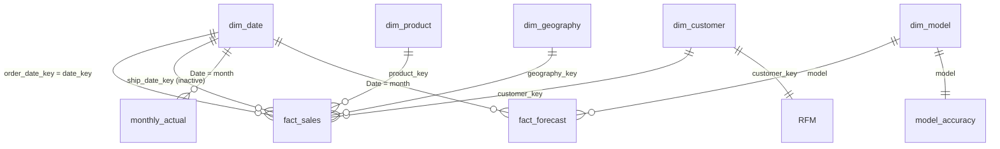

# Data model (star schema plus forecast tables)

Status: designed, NOT yet built in Power BI Desktop. Column names are the ones produced by
the M scripts in `../power_query` (after their rename steps).

## Tables

| Table | Source CSV | Rows | Key | Notes |
|---|---|---|---|---|
| fact_sales | data/curated/fact_sales.csv | 9,994 | row_id | Grain: one order line. Columns: row_id, order_id, order_date_key, ship_date_key, customer_key, product_key, geography_key, ship_mode, sales, quantity, discount, profit. M adds order_date, ship_date, days_to_ship, discount_band, discount_band_sort, is_loss_line |
| dim_date | data/curated/dim_date.csv | 1,826 | date_key (yyyymmdd) | 2015-01-01 to 2019-12-31 (covers forecast year). Renamed to Date, Year, Quarter, MonthNumber, MonthName, YearMonth ... Mark as date table on `Date` |
| dim_customer | data/curated/dim_customer.csv | 793 | customer_key | CustomerID, CustomerName, Segment |
| dim_product | data/curated/dim_product.csv | 1,862 | product_key | ProductID, ProductName, Category, SubCategory |
| dim_geography | data/curated/dim_geography.csv | 632 | geography_key | Country, Region, State, City, PostalCode (text), Location |
| monthly_actual | data/forecast/monthly_sales_actual.csv | 48 | month | month, actual_sales (Jan 2015 - Dec 2018) |
| fact_forecast | holdout_predictions.csv + sales_forecast.csv | long table | month + model + kind | kind = Holdout (2018, 3 models, has actual) or Future (2019, best model, has 95% interval) |
| model_accuracy | data/forecast/model_accuracy.csv (typed into M) | 3 | model | MAE, RMSE, MAPE_pct, rank_rmse |
| dim_model | derived from model_accuracy | 3 | model | Lookup for the Model slicer: model_short, model_family, model_sort |
| RFM (calculated) | DAX | 793 | customer_key | Recency, Frequency, Monetary, RFMSegment |
| Top N (calculated) | DAX | 18 | Value | Slicer helper, 3..20 |
| _Measures | empty table | 0 | - | Holds all measures |

## Relationships

| From (many) | To (one) | Cardinality | Active | Direction |
|---|---|---|---|---|
| fact_sales[order_date_key] | dim_date[date_key] | many-to-one | yes | single |
| fact_sales[ship_date_key] | dim_date[date_key] | many-to-one | NO (inactive, role-playing) | single |
| fact_sales[customer_key] | dim_customer[customer_key] | many-to-one | yes | single |
| fact_sales[product_key] | dim_product[product_key] | many-to-one | yes | single |
| fact_sales[geography_key] | dim_geography[geography_key] | many-to-one | yes | single |
| dim_customer[customer_key] | RFM[customer_key] | one-to-one | yes | single (dim to RFM) |
| monthly_actual[month] | dim_date[Date] | many-to-one | yes | single |
| fact_forecast[month] | dim_date[Date] | many-to-one | yes | single |
| fact_forecast[model] | dim_model[model] | many-to-one | yes | single |
| model_accuracy[model] | dim_model[model] | one-to-one | yes | single |

Notes
- monthly_actual and fact_forecast join on the first day of the month, which exists in dim_date[Date].
  Use dim_date[MonthStart] or the month column itself on a trend axis so values line up.
- dim_date[Date] must be unique and complete (it is, one row per day) before it is marked as the date table.
- Do not use bi-directional filters; none of the measures need them.
- Check the RFM relationship against the comment in `../dax/measures.dax`.

## Diagram



Text version
```
              dim_product   dim_geography   dim_customer --1:1-- RFM
                    \            |            /
                     \           |           /
 dim_date --(active)-- fact_sales  (ship_date_key: inactive to dim_date)
    |  \
    |   +-- monthly_actual
    +------ fact_forecast -- dim_model -- model_accuracy
```

## Expected row-count checks after load
fact_sales 9,994; dim_customer 793; dim_product 1,862; dim_geography 632; dim_date 1,826;
monthly_actual 48; fact_forecast = 36 hold-out rows (3 models x 12) + 12 future rows = 48
(if the CSVs are unchanged; verify in Power Query).
