# Retail Sales Forecasting: A Comparison of ARIMA, SARIMA and Holt-Winters Using an Interactive Power BI Dashboard

**Individual Project (IP), Data Science (DSC), Semester 7**

Student: Mayur Chauhan

Enrollment number: [ADD ENROLLMENT NUMBER]

Institute: L.J. Institute of Engineering and Technology

Guide / Faculty: [ADD NAME]

Date of submission: [ADD DATE]

**Status note.** The data cleaning, ETL, star schema, forecasting, diagnostics and business analytics are complete and were run on the real data. The Power BI dashboard file (.pbix) has NOT been built yet. A build pack (Power Query scripts, DAX measures, data model, theme, wireframes and checklist) exists in the powerbi folder, but no dashboard screenshots are included in this report because none exist.

---

## Abstract

Retail managers need to know what sells, where and when, and what to expect next. This project analyses the public Sample Superstore dataset (9,994 order lines, January 2015 to December 2018, total sales 2,297,201 and profit 286,397) end to end. The raw file is profiled and cleaned (806 stray empty rows removed), loaded through raw, staging, clean and curated zones into a star schema (one fact table and four dimensions) with all 9 row-count reconciliation checks passing, and explored with charts and business analytics (Pareto, RFM, discount versus profit, seasonality). Monthly sales (48 points) are then forecast with Holt-Winters, ARIMA and SARIMA, plus seasonal naive and other baselines. On the single 2018 hold-out, Holt-Winters (additive, damped) had the lowest error (MAE 10,897, MAPE 18.5%), followed by SARIMA(1,1,1)(0,1,1,12) (MAE 15,105, MAPE 34.0%) and ARIMA(1,1,1) (MAE 23,451, MAPE 54.1%). A rolling-origin cross-validation with 7 folds confirmed Holt-Winters as first, but showed that SARIMA is not statistically distinguishable from it (Wilcoxon p = 0.375) and did not beat the seasonal-naive baseline on average. The short series (48 months) is the main limitation. A 2019 forecast with bootstrap intervals is produced. The Power BI dashboard is planned but not yet built.

---

## 1. Introduction

Sales data held by a retailer is large and usually untidy. Questions such as which products drive profit, how discounts affect margin, which regions are weak, and how much will be sold next quarter are hard to answer from raw order lines. This project turns the raw order data into a clean, modelled dataset, analyses it, and forecasts monthly sales using three classical time-series methods that are compared fairly on the same data.

The project is the Individual Project for the Data Science (DSC) subject. It is based on the topic "Sales Performance Analysis and Interactive Dashboard Using Power BI", extended with data cleaning, a data-warehouse style ETL and a forecasting comparison. The work is organised around DSC Chapters 6 to 10.

## 2. Background

This section is deliberately brief and describes standard ideas only. No external papers are cited, because none were reviewed for this report; a proper literature review is listed under future work.

**Time series.** A monthly sales series is commonly described as a combination of a trend (long-run direction), a seasonal pattern (a repeating yearly shape) and a remainder (irregular variation). Decomposition separates these parts. STL is one decomposition method; in this project STL gave a seasonal strength of 0.86 and a trend strength of 0.53.

**Stationarity.** Many classical models (the ARIMA family) assume the series has a stable mean and variance over time. A non-stationary series is made stationary by differencing: a regular difference (d = 1) removes a trend, and a seasonal difference (D = 1 at lag 12) removes a repeating yearly pattern. The Augmented Dickey-Fuller (ADF) test has the null hypothesis of a unit root (non-stationary); the KPSS test has the opposite null (stationary). Using both together is good practice.

**Holt-Winters (exponential smoothing).** Keeps smoothed estimates of level, trend and seasonal components and updates them each month with weights that decay with age. The additive form adds the seasonal effect; the multiplicative form scales by it. "Damped" trend lets the trend flatten over the forecast horizon.

**ARIMA and SARIMA.** ARIMA(p,d,q) combines autoregression (p lags), differencing (d) and moving-average terms (q). SARIMA adds a seasonal part (P,D,Q,m). They need enough data to estimate these parameters.

**Star schema.** A data-warehouse design with a central fact table (measures such as sales, quantity, profit) joined by surrogate keys to small descriptive dimension tables (date, product, customer, geography). It supports OLAP operations such as roll-up, drill-down, slice and dice.

**Gradient descent.** An iterative optimiser that moves model parameters in the direction that reduces a cost function, with step size set by a learning rate.

## 3. Objectives

1. Profile and clean the raw sales data (missing values, duplicates, inconsistent text, data types).
2. Build a star schema (fact and dimension tables) using an ETL process across data-lake zones.
3. Analyse sales and profit by category, region, segment, product and time.
4. Forecast monthly sales with Holt-Winters, ARIMA and SARIMA, compare them on the same hold-out period with MAE, RMSE and MAPE, and choose the best method.
5. Prepare an interactive Power BI dashboard and this report. (The dashboard objective is only partly met: the inputs and the build pack are ready, the .pbix is not built.)

## 4. Dataset

The data is the public "Sample - Superstore" retail dataset, a real copy downloaded from a public GitHub repository, stored unchanged in data/raw/superstore.csv. It holds 9,994 genuine order lines from 2015-01-03 to 2018-12-30 with order and ship dates, ship mode, customer, segment, country, city, state, postal code, region, product, category, sub-category, sales, quantity, discount and profit.

Caveat found while profiling: this copy has 806 stray rows appended at the end (remnants of other spreadsheet sheets, with all business columns empty), so the file has 10,800 rows. The 504 "duplicate rows" and most "missing values" in the raw profile come from these stray rows. The real data has only 11 missing Postal Codes (Burlington, Vermont). It is public sample data, not records of a real company.

Overview of the cleaned data: 5,009 orders, 793 customers, 1,862 products, 17 sub-categories in 3 categories, 4 regions, 49 states, 531 cities. Yearly sales: 2015: 484,247; 2016: 470,532; 2017: 609,206; 2018: 733,215. Overall profit margin 12.5%.

## 5. Methodology (mapped to DSC Chapters 6 to 10)

The pipeline is 11 Python scripts (appendix A) run in order by run_all.py. Tools: Python (pandas, numpy, matplotlib, statsmodels, scikit-learn). Power BI Desktop is planned for the dashboard.

| DSC chapter | What was done | Script | Main outputs |
|---|---|---|---|
| Ch 6 Data Transformation and Data Integrity | Profiling, cleaning, scaling, encoding, quality scorecard | 01, 02, 11 | cleaning_log.md, data_quality_report.md, data_quality_scorecard.md |
| Ch 7 Optimization in Data Science | MSE cost, gradient descent from scratch vs closed form | 05 | gradient_descent_report.md |
| Ch 8 Data Engineering and Warehousing | ETL zones, star schema, OLAP SQL, lineage, reconciliation | 03, 11 | olap_examples.md, lineage_and_reconciliation.md |
| Ch 9 Time Series Analysis | Decomposition, stationarity, Holt-Winters vs ARIMA vs SARIMA, CV, diagnostics | 04, 07, 08, 09 | model_accuracy.md |
| Ch 10 Visualization and Capstone | EDA charts, business analytics, report, presentation, Power BI plan | 06, 10 | figures/ |

### 5.1 Chapter 6: data transformation and integrity

Cleaning rules and counts are in cleaning_log.md. Summary: 806 stray rows dropped; 0 fully duplicated rows; 0 duplicate Row IDs; 32 text values standardised; 0 unparseable dates; 11 missing Postal Codes handled (filled by the mode of the same city and state where possible, otherwise "Unknown"; all 11 stayed Unknown); 0 invalid quantity or sales; 0 discount out of range; 0 ship-before-order. Checks showed one customer ID maps to one name, but 32 Product IDs carry more than one product name (the star schema keeps the first name). 1,167 sales values above Q3 + 1.5 IQR were flagged but kept, as genuine large orders. Derived columns: order year, month, year-month, ship days, profit margin, unit price.

Scaling and encoding were demonstrated: min-max and z-score formulas matched scikit-learn (True for both); the skewness of Sales fell from 12.97 to 0.28 after a log1p transform. Encodings: one-hot (14 dummy columns), label encoding (Sub-Category, 17 classes) and out-of-fold smoothed target encoding of State. The ML-ready demo file has 9,994 rows and 28 columns.

A data-quality scorecard checks 17 rules across completeness, uniqueness, validity, consistency, timeliness and referential integrity. The unweighted mean score is 99.46%. The lowest rules are RAW completeness (92.54%, because of the stray rows) and Product ID to name consistency (98.28%).

### 5.2 Chapter 7: optimisation

A linear trend, sales = slope x month_index + intercept, was fitted to the 48 monthly totals by gradient descent written from scratch (standardised variables, learning rate 0.1, 200 epochs, start at zero). The result was compared with the closed-form normal equation and numpy polyfit. A learning-rate experiment was run.

### 5.3 Chapter 8: data engineering and warehousing

Zones: raw (untouched download), staging (as-is parquet copy with load timestamp, 10,800 rows), clean (9,994 rows, 27 columns), curated (star schema). The star schema has grain of one order line: fact_sales (9,994 rows) with dim_customer (793), dim_product (1,862), dim_geography (632) and dim_date (1,826 calendar days including ship dates). Surrogate keys are used; order_id is a degenerate dimension; sales, quantity and profit are additive measures, discount is non-additive. Integrity checks (unique keys, no orphan foreign keys, total sales preserved) and 9 reconciliation checks all pass. OLAP-style SQL (roll-up, drill-down, slice, dice, cross-tab, subtotals, year-over-year, running total) was executed on SQLite over the curated tables.

### 5.4 Chapter 9: time series analysis

The series is monthly total sales, 48 points. Steps: decomposition (additive and STL); ADF and KPSS tests on the level, first difference, seasonal difference and both; fitting of Holt-Winters, ARIMA(1,1,1) and SARIMA(1,1,1)(0,1,1,12); evaluation by MAE, RMSE and MAPE on a hold-out of the last 12 months (train: first 36).

Because one 12-month hold-out is a weak basis for choosing a model, the comparison was extended with: seasonal naive, naive, SES, three more Holt-Winters variants, an AICc-chosen ETS, and a SARIMA with a 16-candidate AIC search; rolling-origin expanding-window cross-validation (minimum train 24 months, horizon 6, step 3, giving 7 overlapping folds); MASE (error scaled by seasonal-naive error); paired Wilcoxon and t tests on fold errors; and residual diagnostics (Ljung-Box, Jarque-Bera, Shapiro). The 2019 forecast uses residual-bootstrap intervals (2,000 paths). Category, region and segment series were also forecast with the best model chosen separately per series.

### 5.5 Chapter 10: visualisation and capstone

Exploratory charts (script 06) and business analytics (script 10): Pareto/ABC analysis, discount bands, RFM segmentation by k-means, seasonality index, state and sub-category profit. The Power BI plan: import the curated tables and forecast CSVs, build 3 to 4 pages with KPIs, slicers and a forecast comparison page. This part is NOT built.

## 6. Results

### 6.1 Data cleaning and quality

The 806 stray rows account for the whole difference between 10,800 raw rows and 9,994 clean rows. After cleaning the data has no nulls in the 11 key business columns. Row counts: 10,800 raw, 10,800 staging, 9,994 clean, 9,994 fact.

### 6.2 Exploratory analysis

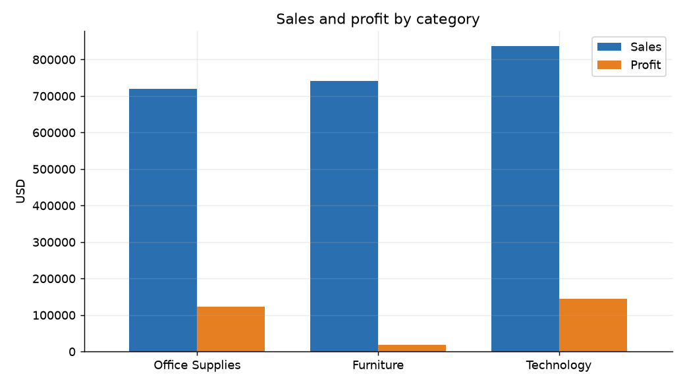

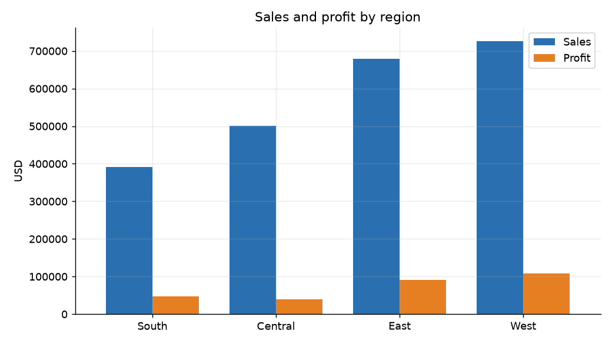

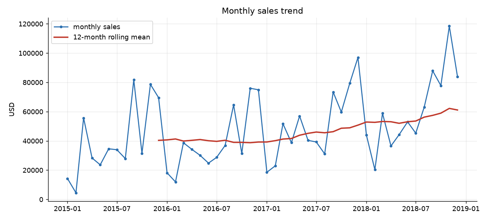

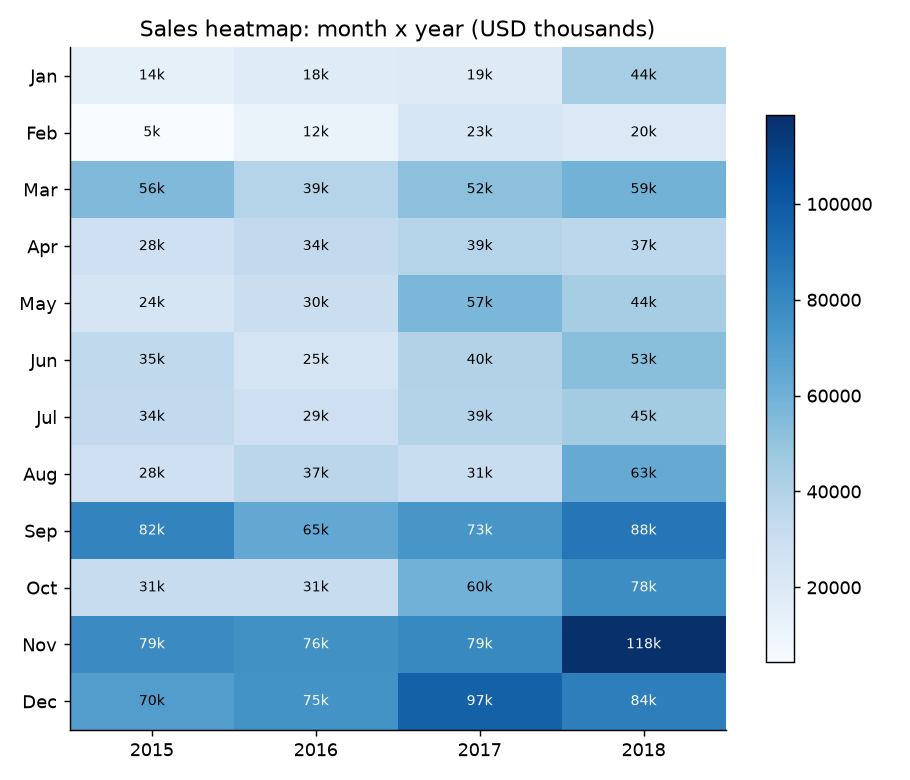

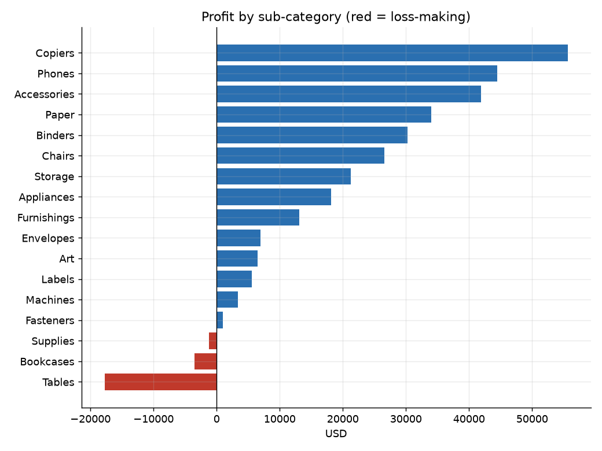

Sales were flat in 2015-2016 (484,247 and 470,532) and grew in 2017 and 2018 (609,206 and 733,215). Sales have a strong yearly pattern: the seasonality index (100 = average month) is 185 for November, 173 for December and 164 for September, and 30 for February and 48 for January (Figure 21 in section 6.9). Copiers (55,618), Phones (44,516) and Accessories (41,937) earn the most profit; Tables (-17,725), Bookcases (-3,473) and Supplies (-1,189) lose money. Machines have a 1.8% margin on 189,239 of sales with an average discount of 31%.

### 6.3 Optimisation: gradient descent

| method | slope (USD per month) | intercept (USD) | MSE (original units) |
|---|---|---|---|
| Gradient descent | 902.01 | 26,661.17 | 465,460,447 |
| Closed form (normal equation) | 902.01 | 26,661.17 | 465,460,447 |
| numpy polyfit | 902.01 | 26,661.17 | 465,460,447 |

Gradient descent reached the closed-form answer (scaled-space MSE 0.748802 for both) and was within 1e-6 of the optimum after about 28 epochs. The trend line has R-squared 0.251 and RMSE 21,574.53, so the linear trend alone explains only a quarter of the variation; the rest is seasonality and noise. Sales grow by about 902 per month on average.

| learning rate | final loss (scaled) | outcome |
|---|---|---|
| 0.001 | 0.862 | converging slowly |
| 0.01 | 0.7489 | converged |
| 0.1 | 0.7488 | converged |
| 0.5 | 0.7488 | converged |
| 1.05 | about 7.5e15 | diverged |

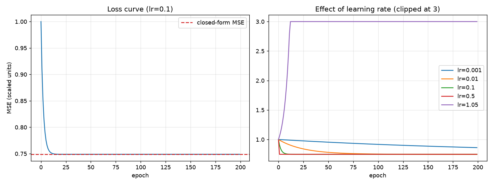

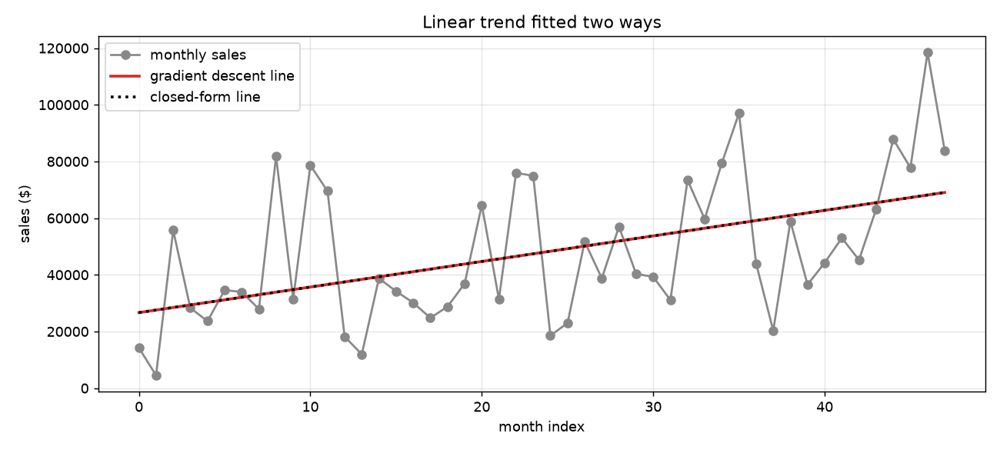

### 6.4 Star schema and reconciliation

All 13 integrity checks in olap_examples.md and all 9 reconciliation checks in lineage_and_reconciliation.md pass (for example: clean rows equal fact rows; sums of Sales, Profit and Quantity are preserved; no orphan keys). The OLAP roll-up from months to quarters to years reproduces yearly totals (2015: 484,247.50 sales and 49,543.97 profit; 2016: 470,532.51 and 61,618.60; 2017: 609,205.60 and 81,795.17; 2018: 733,215.26 and 93,439.27).

### 6.5 Time series: decomposition and stationarity

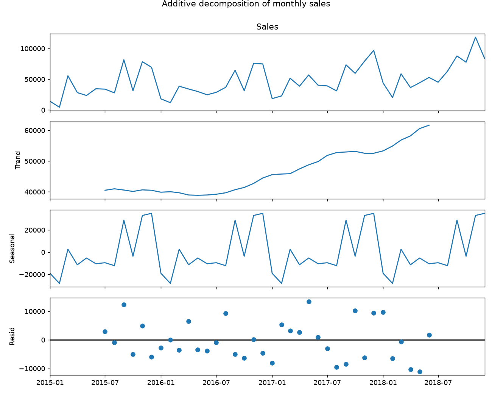

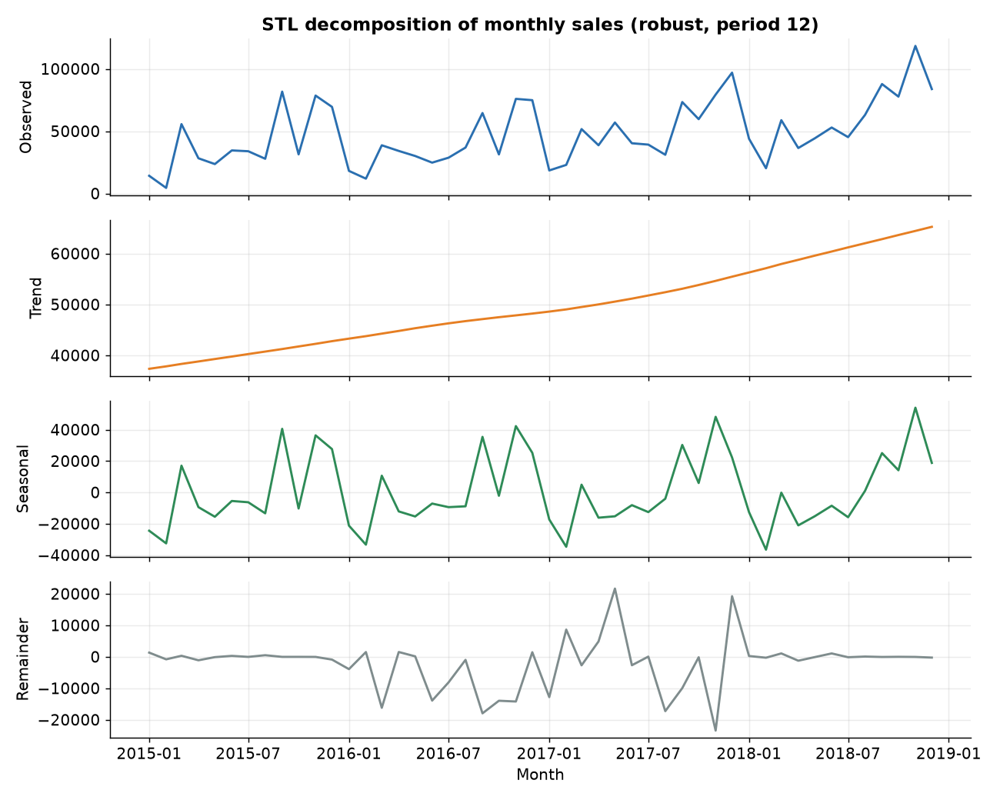

| series | n | ADF p | KPSS p | ADF says | KPSS says |
|---|---|---|---|---|---|
| level | 48 | 0.0002 | 0.0187 | stationary | non-stationary |
| first difference | 47 | 0.0000 | 0.1 | stationary | stationary |
| seasonal difference (lag 12) | 36 | 0.5425 | 0.0491 | unit root | non-stationary |
| d = 1 and D = 1 | 35 | 0.0002 | 0.0465 | stationary | non-stationary |

The tests disagree on the level series, which typically indicates trend or seasonality rather than a true unit root. One regular difference satisfies both tests. The SARIMA specification uses d = 1 and D = 1; with only 35 points left the tests have little power and over-differencing is a real risk, so the decision also relied on the ACF/PACF plots and the AIC search.

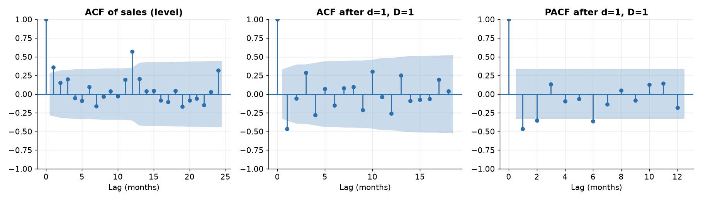

### 6.6 Forecast comparison (the main result)

Single hold-out, train on the first 36 months, test on the 12 months of 2018 (sorted by RMSE):

| model | MAE | RMSE | MAPE % |
|---|---|---|---|
| Holt-Winters (additive, damped) | 10,897 | 14,118 | 18.5 |
| SARIMA(1,1,1)(0,1,1,12) | 15,105 | 17,571 | 34.0 |
| ARIMA(1,1,1) | 23,451 | 27,208 | 54.1 |

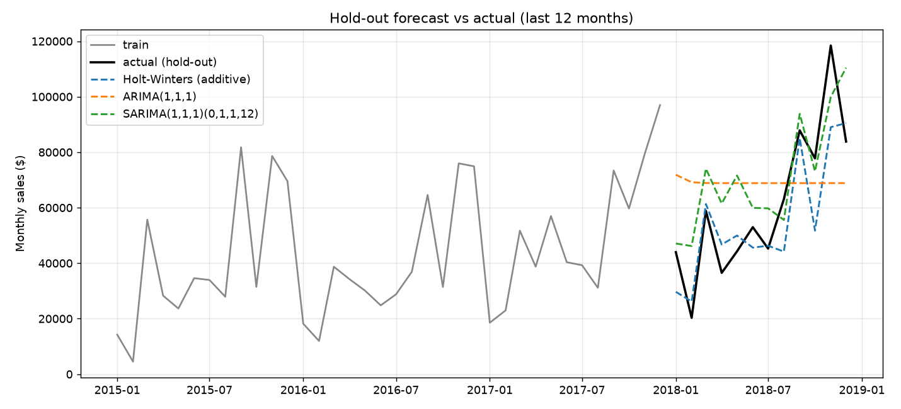

Rolling-origin cross-validation (7 folds, horizon 6), sorted by mean MAE:

| model | CV MAE | MAE SD | CV RMSE | CV MAPE % | 2018 hold-out MAE |
|---|---|---|---|---|---|
| Holt-Winters additive (damped) | 10,981 | 2,729 | 13,445 | 21.7 | 10,897 |
| ETS (AICc-selected) | 11,723 | 3,917 | 14,018 | 22.5 | 11,820 |
| Holt-Winters multiplicative | 11,809 | 2,793 | 14,684 | 23.0 | 13,739 |
| Holt-Winters additive (undamped) | 11,976 | 2,854 | 14,455 | 24.0 | 11,454 |
| Holt-Winters mult. seasonal + damped trend | 13,695 | 5,090 | 16,672 | 26.2 | 13,459 |
| Seasonal naive | 13,739 | 3,265 | 16,542 | 25.0 | 15,468 |
| SARIMA(1,1,1)(0,1,1,12) | 14,513 | 6,974 | 16,199 | 36.6 | 15,105 |
| SARIMA (AIC search) | 14,579 | 7,156 | 16,666 | 35.4 | 15,093 |
| SES | 20,844 | 9,611 | 25,715 | 39.2 | 21,836 |
| ARIMA(1,1,1) | 22,601 | 7,686 | 27,047 | 49.1 | 23,451 |
| Naive | 28,382 | 13,841 | 31,750 | 69.3 | 39,473 |

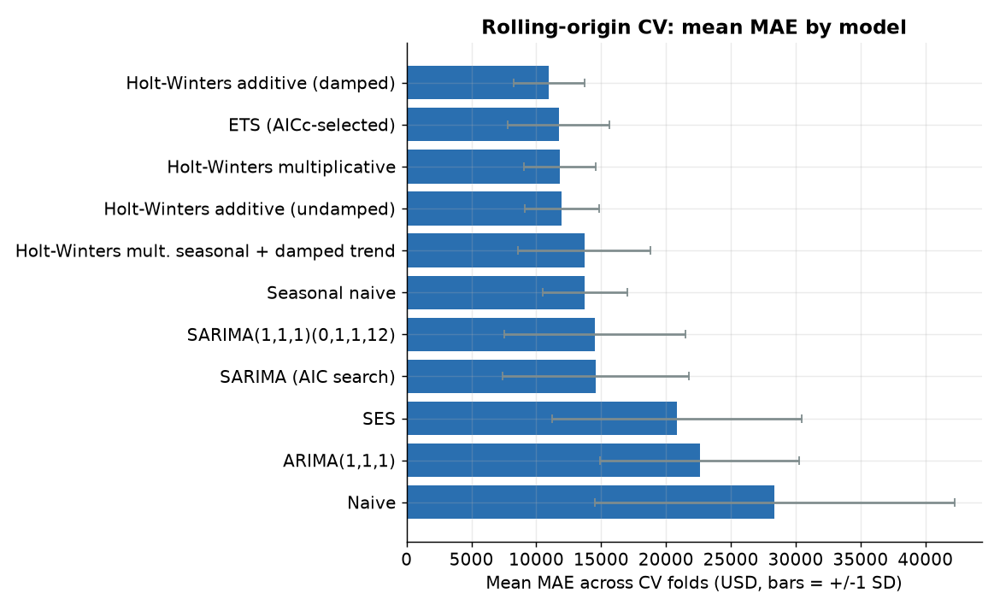

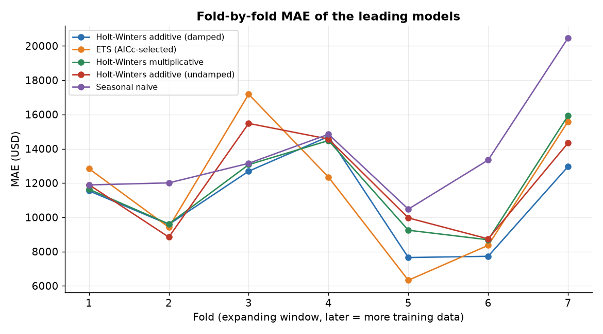

Paired comparison against damped Holt-Winters (mean fold MAE difference, folds where Holt-Winters was better, Wilcoxon p; only 7 overlapping folds, so p-values are indicative): seasonal naive 2,757 (7 of 7, p = 0.016); ARIMA(1,1,1) 11,620 (7 of 7, p = 0.016); SARIMA(1,1,1)(0,1,1,12) 3,532 (4 of 7, p = 0.375); SARIMA AIC search 3,598 (4 of 7, p = 0.375); ETS 742 (4 of 7, p = 0.578); undamped additive 995 (5 of 7, p = 0.109).

Reading: damped Holt-Winters has the lowest mean error and the lowest variation among the strong models, and clearly beats naive, SES and ARIMA(1,1,1). It is not statistically separable from SARIMA, ETS or the undamped version with this little data. SARIMA did not beat the seasonal-naive baseline on average (14,513 vs 13,739).

Why SARIMA struggled: with D = 1 at lag 12, a 24-month training window leaves 12 usable points for up to 5 parameters (24 points at the 36-month origin); seasonal terms are identified from only 2 to 3 repeats of each calendar month; the order chosen by the AIC search changed between folds (data/forecast/cv_sarima_orders.csv). Plain ARIMA has no seasonal term at all, so it cannot reproduce the strong yearly pattern (CV MAPE 49%).

### 6.7 Residual diagnostics and the 2019 forecast

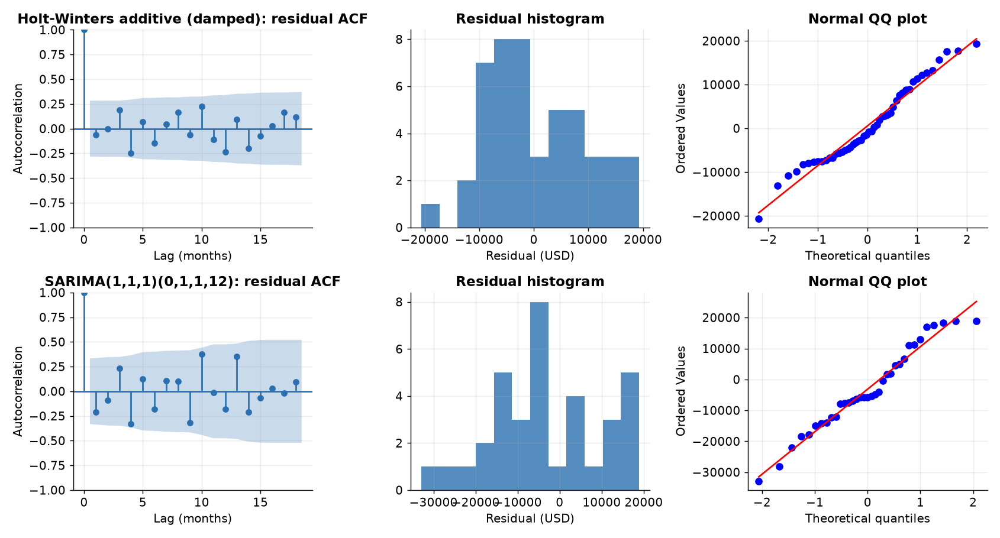

For damped Holt-Winters (48 residuals): Ljung-Box p = 0.329 (lag 6) and 0.165 (lag 12), so no significant leftover autocorrelation; Jarque-Bera p = 0.577 and Shapiro p = 0.181, so no evidence against normality; residual mean 594 and SD 8,984. For SARIMA (35 residuals) Ljung-Box at lag 12 gave p = 0.010, i.e. leftover autocorrelation. With so few residuals these tests are weak, and a pass is not proof.

2019 forecast with the best model refit on all 48 months (bootstrap intervals):

| month | forecast | 80% lower | 80% upper | 95% lower | 95% upper |
|---|---|---|---|---|---|
| 2019-01 | 49,387 | 41,202 | 62,583 | 36,338 | 67,151 |
| 2019-02 | 41,476 | 31,746 | 55,548 | 25,492 | 59,916 |
| 2019-03 | 74,998 | 63,733 | 89,886 | 57,559 | 95,658 |
| 2019-04 | 61,269 | 48,539 | 77,003 | 41,166 | 84,965 |
| 2019-05 | 67,934 | 53,148 | 86,103 | 44,802 | 94,743 |
| 2019-06 | 65,178 | 47,281 | 86,857 | 38,448 | 97,337 |
| 2019-07 | 66,496 | 45,450 | 91,407 | 35,133 | 104,583 |
| 2019-08 | 66,535 | 43,085 | 95,788 | 30,445 | 109,388 |
| 2019-09 | 107,466 | 80,702 | 141,592 | 65,541 | 158,153 |
| 2019-10 | 77,579 | 46,860 | 116,715 | 30,833 | 133,992 |
| 2019-11 | 115,687 | 81,167 | 161,129 | 62,640 | 178,961 |
| 2019-12 | 116,031 | 77,778 | 165,381 | 56,622 | 189,080 |

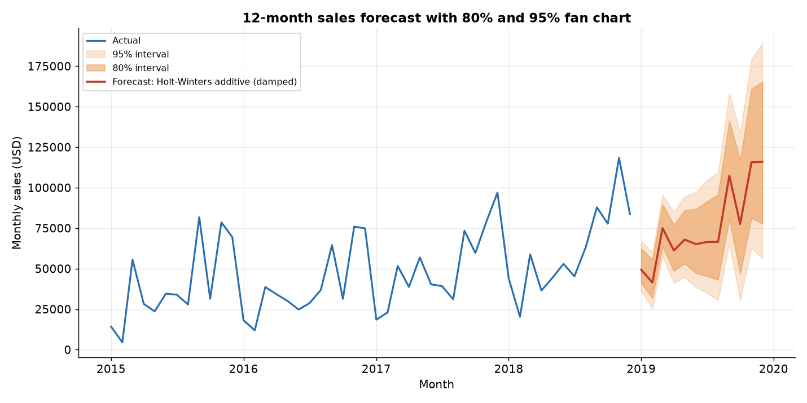

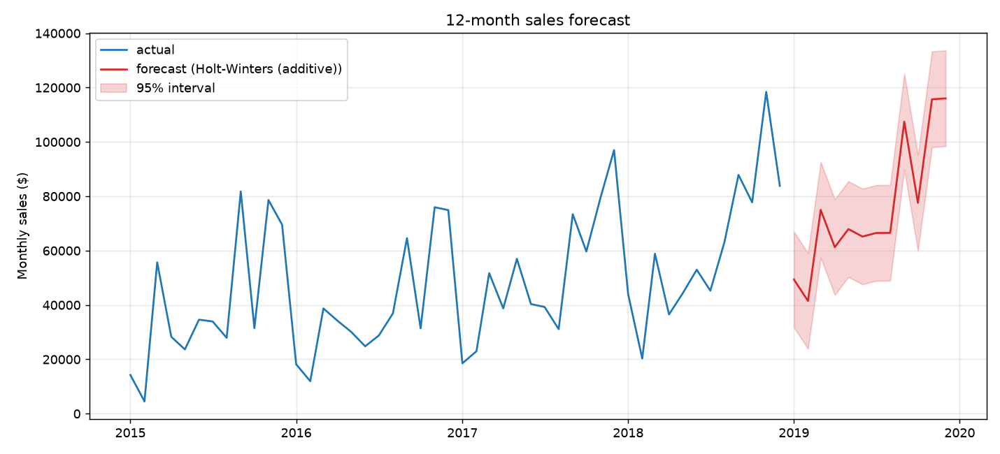

The point forecasts are forecasts, not expected actuals. The intervals widen with the horizon (the December 95% band is 56,622 to 189,080) and will be too narrow if the model is wrong.

### 6.8 Category, region and segment forecasts

The best model differs by series (chosen by CV MAE):

| series | best model | CV MAE | 2018 hold-out MAPE % |
|---|---|---|---|
| Category: Furniture | Seasonal naive | 3,344 | 24.0 |
| Category: Office Supplies | HW additive damped | 5,182 | 24.1 |
| Category: Technology | SARIMA(1,1,1)(0,1,1,12) | 7,595 | 46.8 |
| Region: Central | Seasonal naive | 4,836 | 41.4 |
| Region: East | HW additive damped | 6,055 | 39.7 |
| Region: South | HW additive damped | 4,462 | 59.7 |
| Region: West | HW additive damped | 4,130 | 15.4 |
| Segment: Consumer | HW multiplicative | 6,770 | 32.6 |
| Segment: Corporate | HW additive damped | 5,558 | 49.7 |
| Segment: Home Office | Seasonal naive | 4,667 | 41.4 |

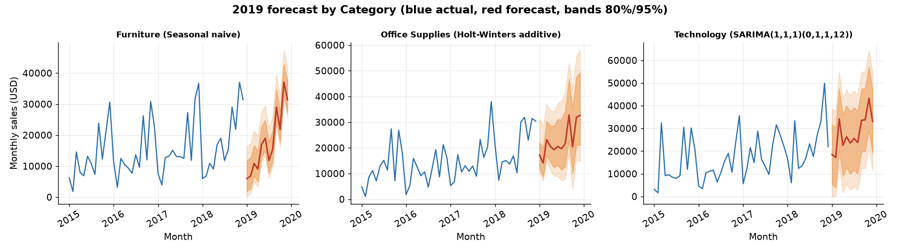

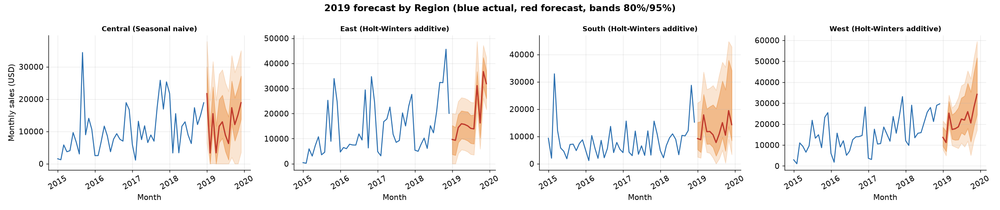

Where seasonal naive wins, the 2019 forecast simply repeats 2018. Hold-out errors of 15% to 60% MAPE mean these forecasts are directional, not precise. SARIMA is best for the Technology category, so the conclusion "Holt-Winters is best" applies to the total series, not to every series.

### 6.9 Business analytics

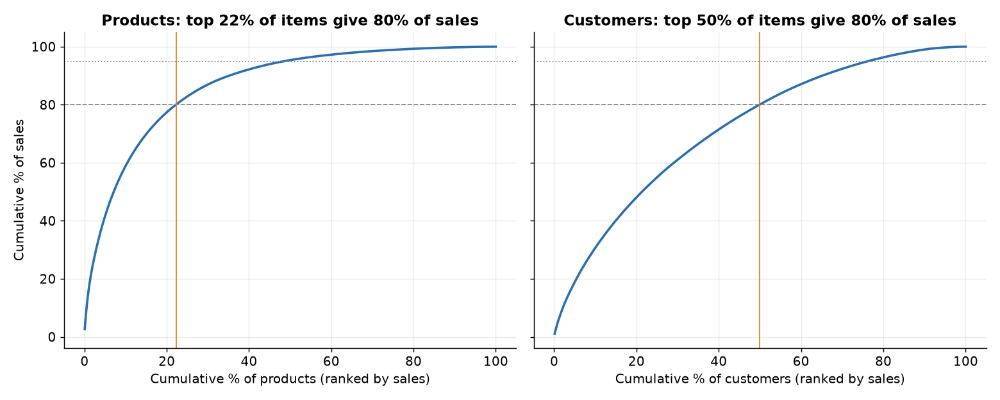

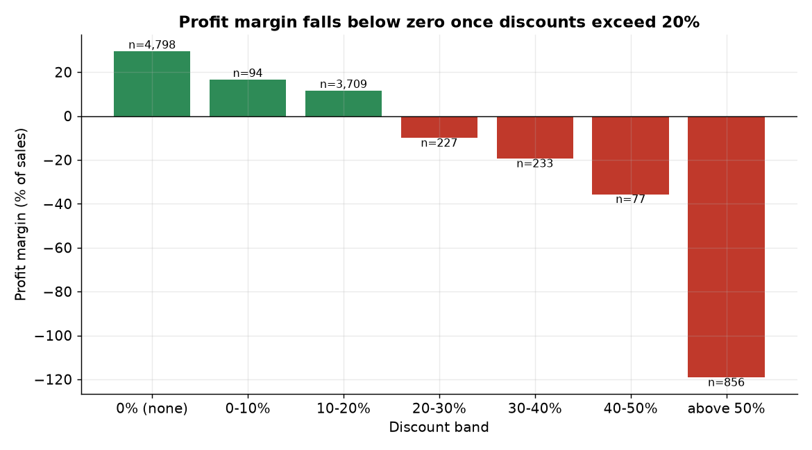

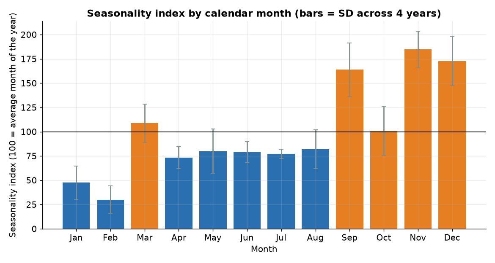

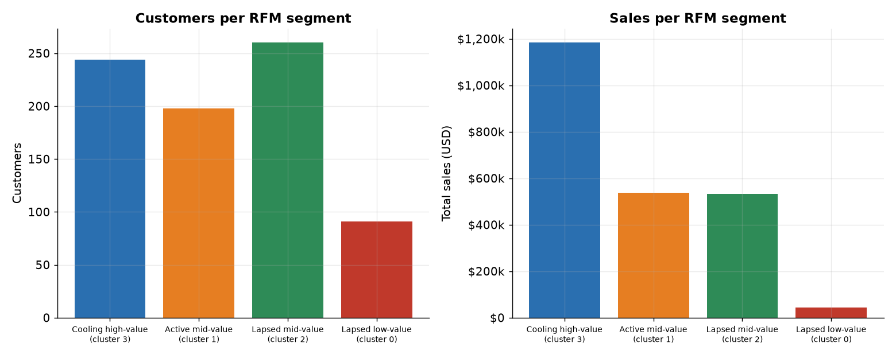

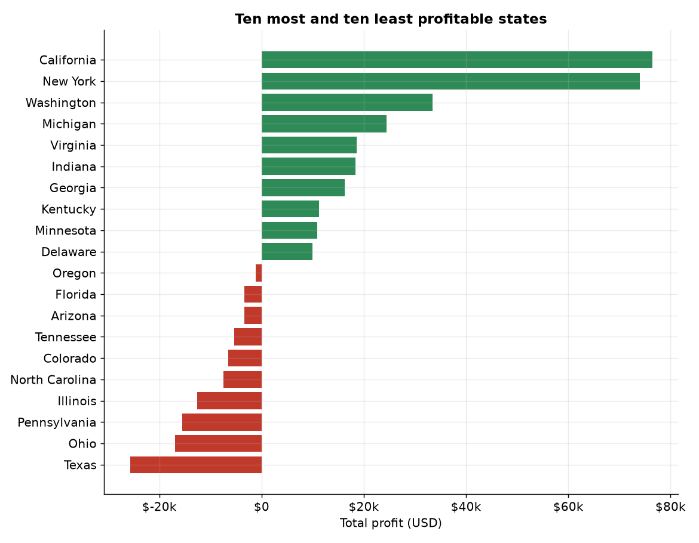

Pareto: 414 of 1,862 products (22.2%) give 80.0% of sales and 70.6% of profit (class A); 959 products (51.5%) are class C with 5.0% of sales. Customers are less concentrated: 396 of 793 (49.9%) give 80.1% of sales.

Discount versus profit: margin is 29.5% with no discount (4,798 lines), 11.6% at 10-20%, and negative from 20%: -10.1% (20-30%), -19.4% (30-40%), -35.7% (40-50%), -119.2% above 50% (856 lines, all loss-making). Lines with discount above 20% lose 135,376 in total (1,393 lines). The Spearman correlation of discount and profit per line is -0.54. This is an association, not proof of cause: heavily discounted lines cluster in certain sub-categories, so product mix is a confounder.

RFM with k-means (k = 4): Cooling high-value 244 customers (30.8% of customers, 51.5% of sales, average recency 98 days); Active mid-value 198 (23.4% of sales, 20 days); Lapsed mid-value 260 (23.2%, 229 days); Lapsed low-value 91 (1.9%, 328 days). The segment names are labels assigned from recency and spend thresholds in the script; k-means does not output names. The silhouette score is highest at k = 2 (0.350) and is 0.254 at k = 4; k = 4 was chosen for interpretability.

### 6.10 Power BI dashboard (status)

The Power BI dashboard is NOT built. What exists: curated tables and forecast CSVs ready to import, Power Query scripts, DAX measures with expected values computed from the CSVs, a data-model description, theme, page wireframes and a build checklist, all in the powerbi folder, with every checklist item still unticked. No dashboard screenshot is included because there is none. Building it, exporting a PDF and checking its values against the numbers in this report are the main remaining tasks.

## 7. Discussion

**Which method is best?** For the total monthly series, damped additive Holt-Winters is the best of the three required methods on every measure used: the 2018 hold-out (MAPE 18.5% vs 34.0% and 54.1%), the cross-validation mean (MAE 10,981) and fold-to-fold stability (MAE SD 2,729 vs 6,974 for SARIMA). Plain ARIMA is worst because it has no seasonal component and this series is strongly seasonal (STL seasonal strength 0.86).

**Why not SARIMA?** In principle SARIMA can match Holt-Winters. Here it is penalised by data length: after one regular and one seasonal difference very few points remain for the parameters, and the estimates are unstable across folds. Its leftover residual autocorrelation (Ljung-Box lag 12 p = 0.010) also suggests a poor fit. We should not conclude that SARIMA is a bad method; only that with 48 monthly points it is not better than simpler methods.

**How strong is the evidence?** Moderate. Holt-Winters beats the seasonal-naive baseline in all 7 folds and ARIMA(1,1,1) in all 7 folds. But against SARIMA the gap is not significant (p = 0.375) and against ETS or the undamped version differences are within fold noise. The folds overlap and are not independent, and the smallest p-value possible with 7 folds is 0.016. The choice of damped Holt-Winters is therefore tentative.

**Absolute accuracy.** Even the best model has a 2018 MAPE of 18.5% and CV MAPE of 21.7%, which is moderate. Sales also have large peaks in September, November and December and a few outlying months that no simple model captures.

**Business findings.** Sales are heavily seasonal, with a Q4 peak; discounts above 20% are loss-making on average; 22.2% of products bring 80% of sales; some sub-categories (Tables, Bookcases, Supplies) lose money; Machines combine high sales with a 1.8% margin.

**Engineering.** The pipeline is reproducible, reconciled at every stage (9 of 9 checks) and scores 99.46% on the quality scorecard. An honest finding is that many cleaning steps produced zero counts, because the real data is already tidy apart from the stray rows and 11 postal codes.

## 8. Limitations

1. Small sample: 48 monthly points; SARIMA in particular is data-hungry.
2. The 7 cross-validation folds overlap, so p-values are indicative only.
3. Model choice is tentative: damped Holt-Winters leads ETS, undamped Holt-Winters and SARIMA by amounts within fold variation.
4. Forecasts assume the 2017-2018 growth and seasonal pattern continue; sales were flat in 2015-2016.
5. Prediction intervals are bootstrap or model-based approximations and are likely too narrow if the model is wrong.
6. Category, region and segment series are noisier, with hold-out MAPE of 15% to 60%.
7. Discount and RFM findings are observational (association, not cause); RFM depends on the snapshot date and on k.
8. The data is a public sample, not a real company, and 806 stray rows had to be removed.
9. The Power BI dashboard is not built, so the interactive part of the title is not yet delivered.
10. No external literature was reviewed; the background section is textbook-level only.
11. Only classical univariate methods were tried; no promotion, price or holiday variables.

## 9. Conclusion

The project cleaned the Superstore data, built a reconciled star schema, analysed sales and profit, and compared three forecasting methods on monthly total sales. Damped additive Holt-Winters was the most accurate and the most stable (hold-out MAE 10,897, MAPE 18.5%; CV MAE 10,981). SARIMA was second on the hold-out but not significantly different from it, and not better than seasonal naive on average; ARIMA without a seasonal term was the worst. The main reason SARIMA underperformed is the short series. Gradient descent reproduced the closed-form trend exactly (slope 902.01 per month). The pipeline, reports and forecast files are complete. The Power BI dashboard remains to be built.

## 10. Future work

1. Build the Power BI dashboard from the existing build pack, check every KPI against this report, export PDF.
2. Test on a longer series or a different retail dataset where SARIMA has more data.
3. Try regression with calendar, promotion and price variables, and machine-learning models, using the same rolling-origin evaluation.
4. Forecast at product or sub-category level with hierarchical reconciliation.
5. Carry out a proper literature review and cite sources.
6. Use a business metric (stock-out or over-stock cost) in addition to MAE and MAPE.

---

## Appendix A. Scripts

All scripts are in the scripts folder and run in order with `python scripts/run_all.py` (Python 3.11, requirements in requirements.txt).

| script | lines | purpose | chapter |
|---|---|---|---|
| 01_data_quality_report.py | 91 | Profile raw data: missing values, duplicates, types | Ch 6 |
| 02_clean_transform.py | 163 | Clean data, derive columns, scaling and encoding demos, cleaning log | Ch 6 |
| 03_etl_star_schema.py | 125 | Staging, surrogate keys, dimensions and fact, integrity asserts, OLAP SQL | Ch 8 |
| 04_timeseries_forecast.py | 127 | Decomposition, ADF, hold-out comparison of Holt-Winters, ARIMA, SARIMA, 12-month forecast | Ch 9 |
| 05_gradient_descent_trend.py | 101 | Gradient descent vs closed-form linear trend, learning-rate experiment | Ch 7 |
| 06_eda_charts.py | 97 | Ten exploratory charts | Ch 10 |
| 07_cv_evaluation.py | 127 | Rolling-origin CV of 11 models, MASE, paired tests | Ch 9 |
| 08_diagnostics_forecast.py | 130 | ADF/KPSS, Ljung-Box, residual plots, 2019 bootstrap interval forecast | Ch 9 |
| 09_segment_forecasts.py | 82 | Category, region and segment forecasts | Ch 9 |
| 10_business_analytics.py | 173 | Pareto, RFM, discount bands, seasonality, state and sub-category profit | Ch 10 |
| 11_data_engineering_extras.py | 191 | Data dictionary, scorecard, lineage and reconciliation, extra OLAP SQL | Ch 6, 8 |
| common.py, style.py, tsmodels.py, run_all.py | 56, 19, 148, 17 | Shared paths, chart style, time-series model wrappers, runner | all |

## Appendix B. Output files

- reports: RESULTS_SUMMARY.md, model_accuracy.md, cleaning_log.md, data_quality_report.md, data_quality_scorecard.md, data_dictionary.md, lineage_and_reconciliation.md, olap_examples.md, olap_extra_examples.md, gradient_descent_report.md, and 34 PNG figures in reports/figures.
- data/clean, data/curated (star schema), data/forecast (forecast and accuracy CSVs), data/analytics (business analytics CSVs).
- powerbi: build pack only (no .pbix).

## Appendix C. Run instructions

```
cd IP_Retail_Sales_Analytics
pip install -r requirements.txt
python scripts/run_all.py
```
